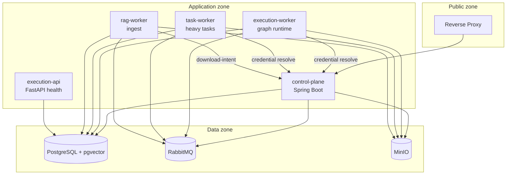

# System Overview

## Goal

Authenticated users compose AI workflows from versioned nodes, publish immutable versions, run them via manual/webhook/scheduled triggers, inspect live history, use project-scoped RAG, pause for human approval, and run durable heavy tasks (research, screening, cleanup).

## Containers (backend-relevant)



Only the proxy exposes public ports. FastAPI, internal Spring endpoints, Postgres, RabbitMQ, and MinIO stay private.

## Service responsibilities

| Service / process | Owns | Does not own |
| --- | --- | --- |
| **control-plane** | Identity, authz, drafts/versions, credentials, triggers, datasets metadata, run read models, outbox commands, SSE, approvals | Graph execution, embeddings, provider AI calls, `task.start` |
| **execution-api** | Health/readiness probes | Workflow execution over HTTP |
| **execution-worker** | Command consume, graph interpret/run, event emit, task dispatch/resume coordination | Platform user tables, browser APIs, document ingest |
| **task-worker** | Durable heavy jobs with item checkpoints, progress, artifacts | Parent graph orchestration |
| **rag-worker** | Document ingest/delete, vector writes (`rag.*`) | Workflow execution |

## Repository layout (backend)

```text
ai_workflow/
|-- services/
|   |-- control-plane/          # Java / Spring Boot
|   |-- execution-engine/       # Python (api + workers share codebase)
|   `-- rag/                    # ingest/delete worker
|-- contracts/                  # Canonical JSON Schema + fixtures
|-- infra/                      # RabbitMQ, MinIO, proxy config
`-- design/                     # This pack (HLD, LLD, plan, service packs)
```

## MVP capability groups

1. **Foundation** — contracts, scaffolds, Compose infra, CI fixtures.
2. **Control** — auth, projects, drafts, validation (ports + input bindings), publish, catalog.
3. **Execution core** — outbox/inbox, Input→Output run (hybrid wiring: edges + bindings), SSE, restart recovery.
4. **Nodes** — condition, merge, loop, prompt, chat.
5. **Ops** — credentials, triggers, HTTP action, cancel/retry/timeout.
6. **RAG + human** — ingest (rag-worker), retrieve, approval/review interrupts.
7. **Heavy tasks** — for-each/collect, research, momentum, cleanup.

## Quality bar for every service change

- Tests first for behavior; ≥80% coverage on changed code.
- Shared contract fixtures pass in Java and Python.
- No secrets in logs, events, API responses, or snapshots.
- Idempotent message handlers.
- Liveness ≠ readiness; readiness checks role-specific deps.
