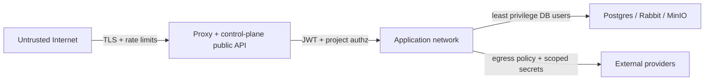
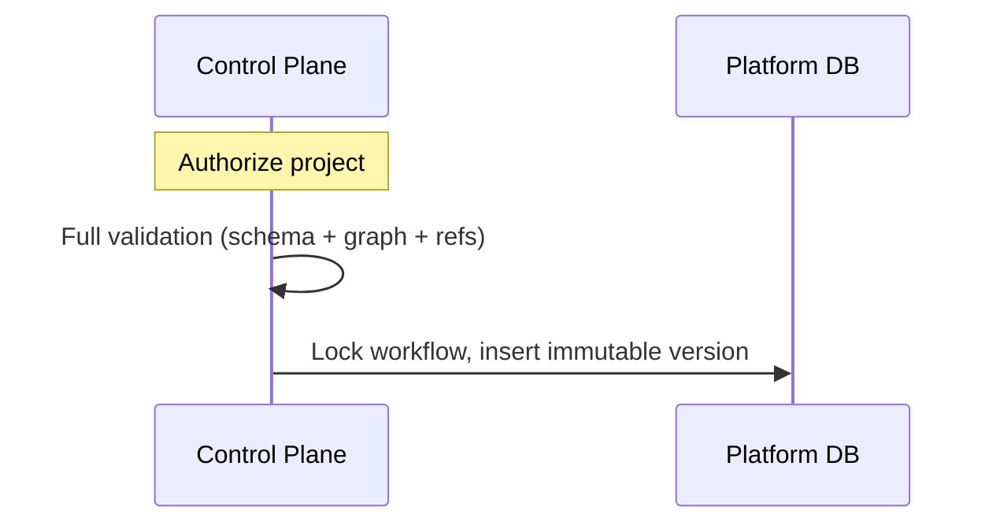
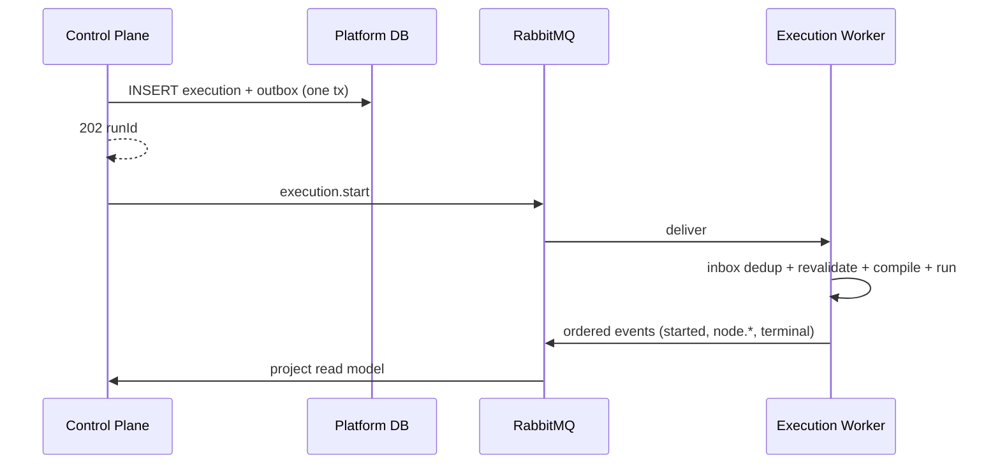
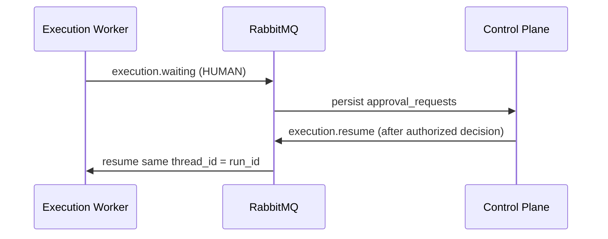
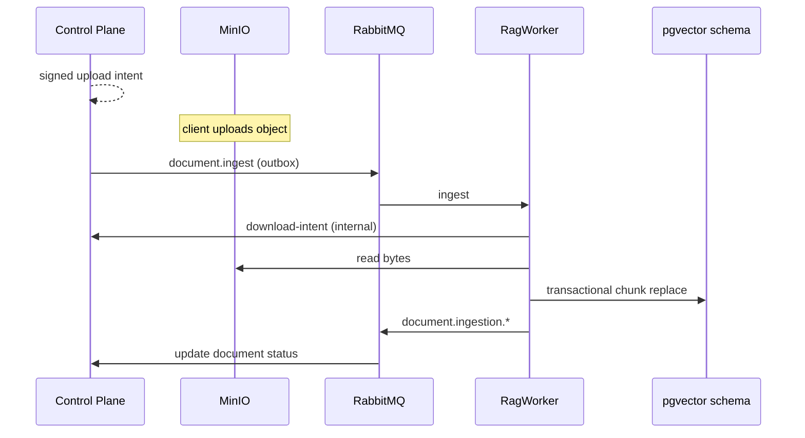
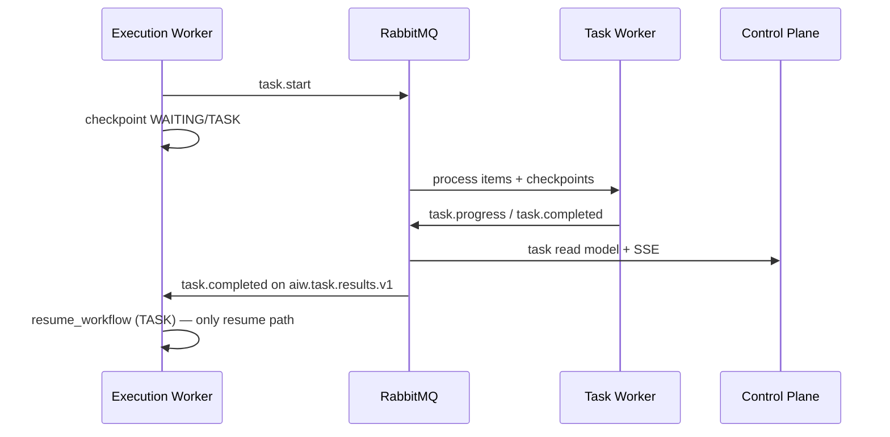
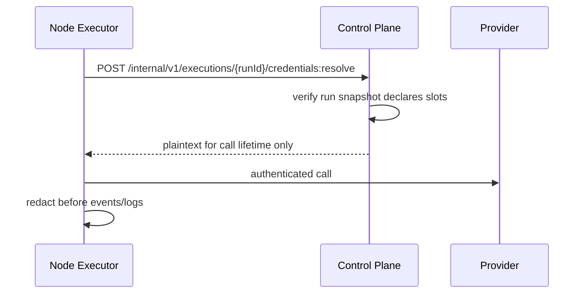

# Service Interactions

How backend services collaborate. Frontend is out of scope; it only calls the control plane.

## Interaction matrix

| From → To | Mechanism | Purpose |
| --- | --- | --- |
| Client → control-plane | HTTPS REST `/api/v1`, SSE, `/hooks/v1` | All product operations |
| control-plane → RabbitMQ | Outbox publish to `aiw.commands.v1` | `execution.start` / `execution.cancel` / HUMAN `execution.resume` / `document.ingest` / `document.delete` / user `task.cancel` (never `task.start`) |
| RabbitMQ → execution-worker | Queue `aiw.execution.commands.v1` | Run graphs, resume, cancel |
| RabbitMQ → rag-worker | Queue `aiw.ingestion.commands.v1` | Document ingest/delete, vector writes |
| RabbitMQ → task-worker | Queue `aiw.task.commands.v1` | Heavy jobs |
| execution / task workers → RabbitMQ | Publish to `aiw.events.v1` | Ordered run/node/task/document events |
| RabbitMQ → control-plane | Queue `aiw.control.events.v1` | Project read models + SSE |
| Workers → control-plane | Internal HTTPS `/internal/v1` | Credential resolve, document download intent |
| Workers → MinIO | S3 API (via signed intents or service creds) | Read docs / write artifacts |
| control-plane → MinIO | Signed upload/download | User uploads, artifact download |
| Workers → providers | HTTPS | Chat, embeddings, market, research, HTTP action |

## Trust boundaries

- Public clients never reach Python or internal endpoints.
- Internal endpoints require service authentication (service JWT / mTLS later).
- Workers never decrypt credentials locally; Spring verifies the **run snapshot** (draft or published) declares the slot, then decrypts.

## Primary flows

### 1. Publish a workflow

Execution plane is not involved until a run starts.

### 2. Start and execute a run

### 3. Human approval resume

`WAITING` reason must match: human decisions cannot resume `TASK` waits and vice versa.

### 4. Document ingest + RAG

Retrieval (`rag.retrieve@1`) runs in the execution-engine against the same `rag` schema (read-only).

### 5. Durable heavy task

**Locked:** only `execution.resume` / in-process `resume_workflow` continues the parent walker. Task-worker never calls `run_workflow`. Execution-worker consumes `aiw.task.results.v1` and resumes. Control-plane must not also send `execution.resume` for the same TASK interrupt.

### 6. Credential use during a node

## Ownership of failures

| Failure | Owner of response |
| --- | --- |
| Invalid draft / publish | Control plane validation → `422` with field errors |
| Authz / unknown project | Control plane → `403`/`404` |
| Broker down after run commit | Outbox retries until published |
| Duplicate command/event | Consumer inbox / unique constraints → no-op |
| Provider blip | Worker retry policy on node; eventual `node.failed` / run fail |
| Dead-letter | Ops inspect DLQ; create new run (no silent replay into changed graph) |

## Correlation

Every hop should carry:

- `correlation_id` (request/run lineage)
- `causation_id` (parent message)
- `run_id` / `workflow_version_id` when applicable
- `message_id` + `idempotency_key` on broker messages

Logs and traces use the same IDs without secret payloads.
