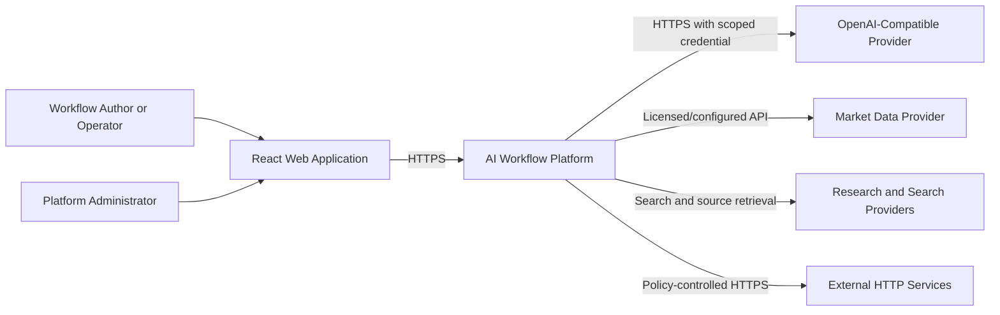
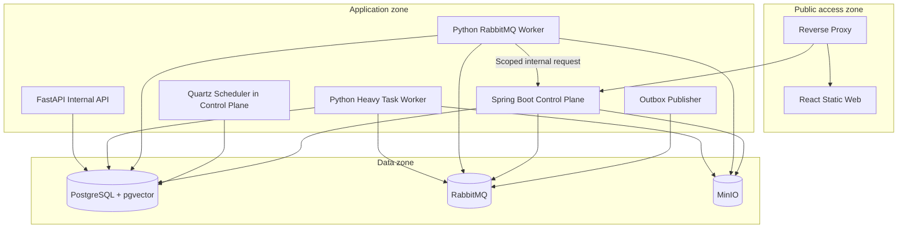
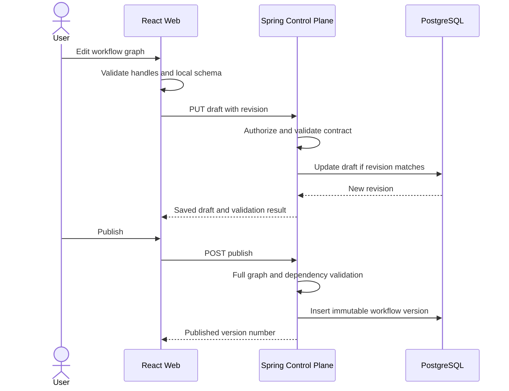
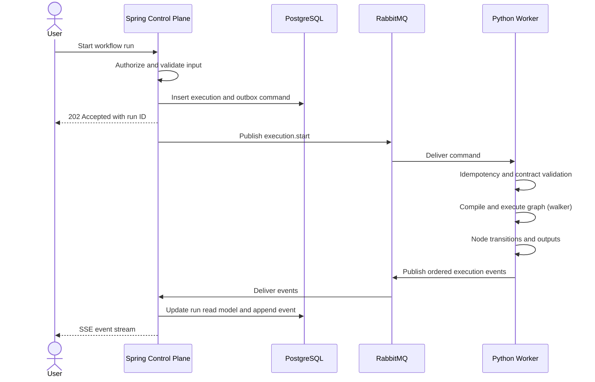
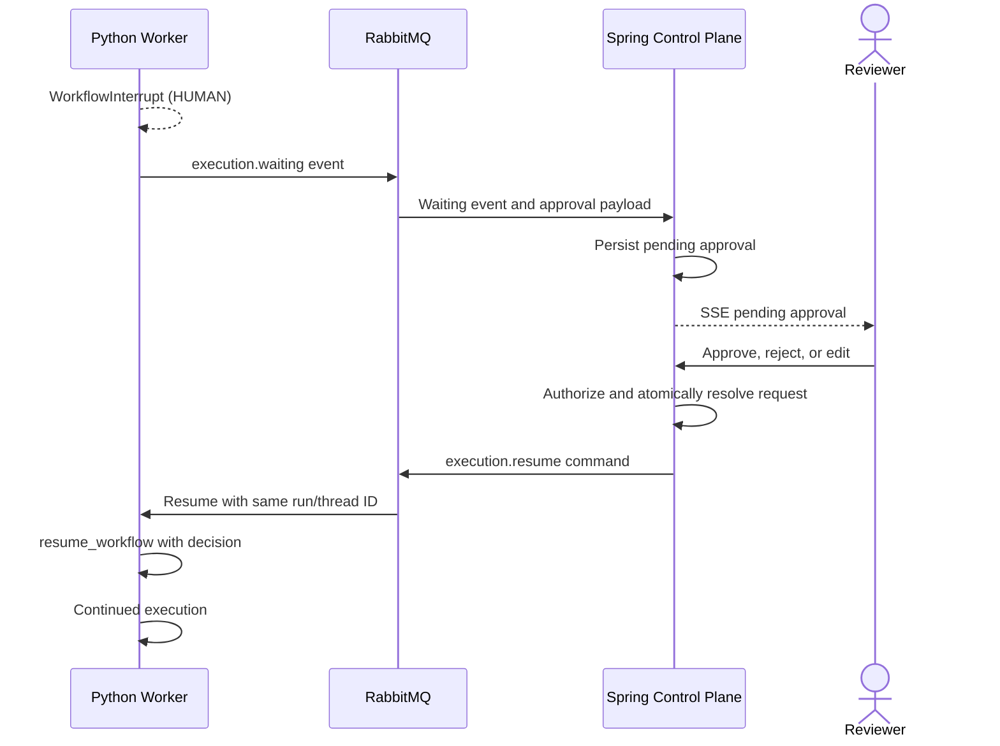
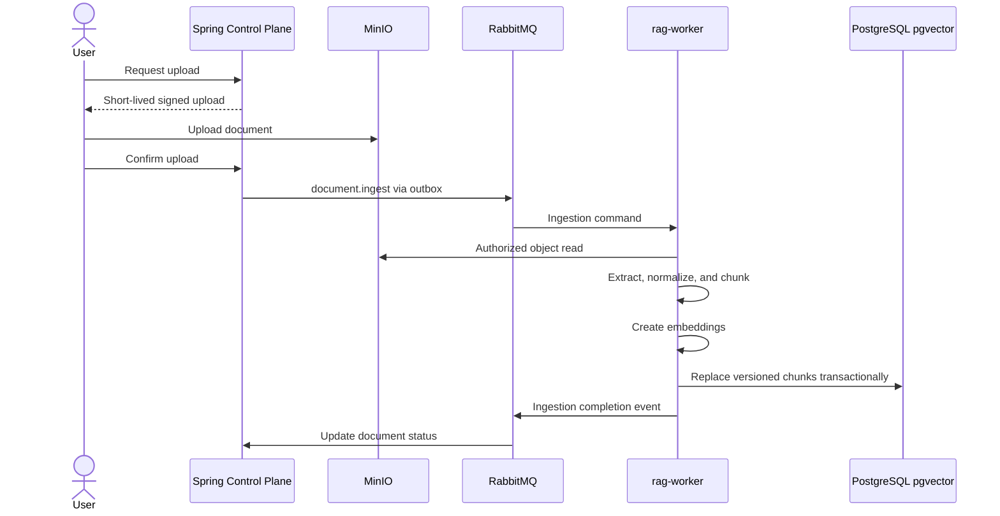
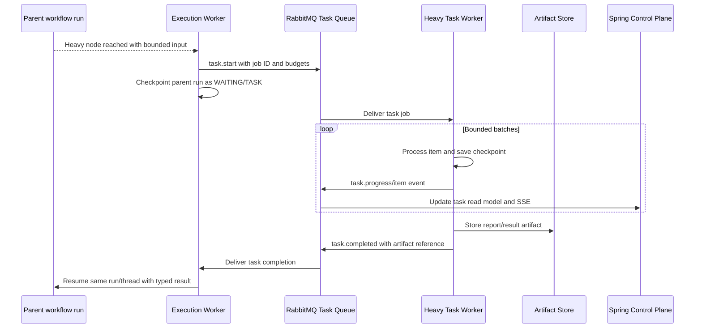
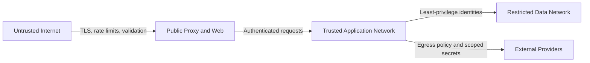

# AI Workflow Platform: High-Level Design

## 1. Document Control

| Field | Value |
| --- | --- |
| Document | High-Level Design (HLD) |
| System | AI Workflow Platform |
| Status | Initial implementation baseline |
| Primary audience | Product engineering, architecture, security, operations, and QA |
| Related documents | `design/plan.md`, `design/LLD.md` |

This document defines the system boundaries, major components, data ownership, integration patterns, trust boundaries, quality attributes, and deployment model. Detailed classes, APIs, tables, message shapes, and algorithms are defined in the LLD.

## 2. Executive Summary

The platform lets authenticated users visually compose AI workflows from versioned nodes, publish immutable workflow versions, execute them from manual/webhook/scheduled triggers, inspect live and historical runs, use project-scoped retrieval-augmented generation (RAG), and pause execution for human approval.

The architecture separates platform governance from AI execution:

- A **React web application** provides the operational user experience.
- A **Spring Boot control plane** is the sole public backend and authoritative owner of identity, authorization, workflow lifecycle, credentials, triggers, and run read models.
- A **Python execution plane** compiles neutral workflow definitions into a durable walker and executes AI, RAG, control, human, and action nodes.
- **RabbitMQ** decouples commands and events with at-least-once delivery.
- **PostgreSQL** provides platform records, durable execution checkpoints, and pgvector search in separately owned schemas.
- **MinIO** stores uploaded source documents.

The persisted workflow format is independent of the walker internals. Product contracts stay in `contracts/`; the execution-engine runner is an internal implementation.

## 3. Goals and Non-Goals

### 3.1 Goals

- Provide a visual, extensible node-based workflow authoring experience.
- Support deterministic control flow and AI-driven processing in the same workflow.
- Support typed connections, structured conditions, fan-out/fan-in, and controlled loops.
- Preserve auditability through immutable published workflow versions.
- Execute asynchronously with retries, timeouts, cancellation, idempotency, and restart recovery.
- Protect user, project, credential, and document boundaries.
- Support OpenAI-compatible chat and embedding providers.
- Support human approval and review through durable execution interrupts.
- Make new node types incremental through manifests and executor registries.
- Support bounded collection processing and independently scalable, durable heavy-task jobs.
- Support explainable stock-watchlist momentum screening, cited research, and approval-gated cleanup through typed provider adapters.
- Run locally and in an initial hosted environment through Docker Compose.

### 3.2 Non-Goals for the MVP

- Arbitrary user-provided code execution.
- Loading untrusted binary or Python plug-ins at runtime.
- Public node marketplace.
- Simultaneous collaborative editing.
- Billing and entitlement management.
- Enterprise federation through OIDC or SAML.
- Kubernetes-native autoscaling and multi-region failover.
- Exactly-once message delivery. The system provides effectively-once outcomes through idempotency.
- Automated brokerage trading or personalized investment advice.
- Unrestricted cleanup of host files, arbitrary databases, or cloud accounts.

## 4. Architectural Principles

1. **Single public backend:** browsers communicate only with the Spring control plane.
2. **Explicit ownership:** each service writes only its owned database schema.
3. **Contract-first integration:** JSON Schema is canonical for workflows, nodes, commands, and events.
4. **Immutable execution input:** production triggers pin a published workflow version.
5. **At-least-once safe:** command and event handlers are idempotent.
6. **No arbitrary expressions:** conditions use a validated abstract syntax tree.
7. **No arbitrary cycles:** loops are explicit, bounded, and budgeted.
8. **Secrets by reference:** persisted graphs and messages contain credential IDs, never secret values.
9. **Defense in depth:** graph validation runs in both Java and Python before execution.
10. **Extensibility at registries:** new nodes add manifests and executors rather than core branching logic.
11. **Operational transparency:** every run and node transition is observable and correlated.
12. **Heavy work is durable:** long tasks become checkpointed jobs with progress, budgets, artifacts, and cancellation.
13. **Destructive work is planned first:** cleanup requires typed scope, dry run, approval, and per-item audit.

## 5. System Context

### 5.1 Actors

| Actor | Primary capabilities |
| --- | --- |
| Workflow author | Create projects and workflows, configure nodes, validate drafts, publish versions, and test runs |
| Operator | Activate triggers, inspect runs, cancel executions, and resolve approvals |
| Administrator | Inspect platform health and audit events; administer platform policy |
| External caller | Invoke a published workflow through a secret webhook endpoint |
| AI provider | Serve chat-completion and embedding requests |
| Market-data provider | Supply timestamped price/volume history for configured watchlists |
| Research/search provider | Return source discovery and retrievable evidence for research jobs |
| External action service | Receive policy-compliant workflow HTTP requests |

## 6. Container Architecture

### 6.1 React Web Application

The web application owns presentation and transient editing state. It renders the workflow canvas from the node catalog and workflow contract, performs immediate usability validation, and delegates authoritative operations to Spring.

Key subsystems:

- Authentication and protected routing.
- Project/workflow navigation.
- React Flow builder.
- Schema-driven node inspector.
- Structured condition editor.
- Dataset, credential, and trigger management.
- Run history and SSE run inspector.
- Approval and review interaction.
- Batch/task progress, artifact preview/download, research citations, and cleanup-plan review.

### 6.2 Spring Boot Control Plane

The control plane is the policy enforcement point and system of record for product state.

Key subsystems:

- Identity and session management.
- Workspace/project authorization.
- Workflow draft, validation, publication, and versioning.
- Node catalog service.
- Credential encryption and scoped resolution.
- Dataset/document metadata and signed object operations.
- Trigger lifecycle and scheduling.
- Execution lifecycle/read model.
- Durable task-job, task-item, and artifact metadata.
- Transactional outbox and event inbox.
- SSE event fan-out and replay.
- Audit logging.

### 6.3 Python Execution Plane

The execution plane receives immutable execution commands and performs runtime work.

Key subsystems:

- Message command consumers.
- Dedicated heavy-task consumers for batch screening, research, and cleanup.
- Cross-contract validation.
- Node registry and executor registry.
- Hybrid workflow wiring: edges/ports (structure) + input bindings (field mapping); see [05-workflow-wiring.md](./05-workflow-wiring.md).
- Neutral graph interpretation (`runtime/runner.py` walker; not a compiled StateGraph).
- Walker execution and PostgreSQL checkpointer (`ee.workflow_checkpoints`).
- Provider, RAG **retrieve**, human interrupt, and action adapters.
- Event publication.
- Cancellation and execution-budget enforcement.
- Per-task checkpoints, progress, artifact publication, and partial-failure policy.

Document ingest/delete is **not** in this plane. `rag-worker` (`services/rag`) consumes `document.ingest` / `document.delete` and owns `rag.*` vectors. Execution-engine retrieval is read-only against that schema.

### 6.4 Infrastructure Components

| Component | Purpose |
| --- | --- |
| Reverse proxy | Same-origin routing, TLS termination in hosted environments, request limits, and public endpoint isolation |
| PostgreSQL | Platform records, Quartz state, outbox/inbox, walker checkpoints (`ee.workflow_checkpoints`), vector chunks, and metadata |
| RabbitMQ | Durable execution, task, resume, cancellation, ingestion commands, and progress/completion events |
| MinIO | S3-compatible document and generated-artifact storage |

## 7. Major Business Flows

### 7.1 Author, Validate, and Publish

Important properties:

- Draft writes use optimistic concurrency.
- Publication validates node versions, ports, conditions, loops, credentials, and collections.
- Published definitions are immutable.
- Active triggers reference a specific published version.

### 7.2 Start and Execute a Workflow

Important properties:

- Creation of the run and outbox command is one database transaction.
- RabbitMQ acknowledgement occurs only after durable processing state is established.
- Duplicate commands and events are discarded using message IDs/idempotency keys.
- Node side effects use a stable execution key.

### 7.3 Human Approval and Resume

Approval nodes must issue one deterministic interrupt per invocation. Non-idempotent side effects occur after the interrupt or in a separate downstream node.

### 7.4 Document Ingestion and RAG

Retrieval always includes workspace, project, dataset, and active-document filters. A workflow cannot retrieve from a collection not authorized at publication and run time.

### 7.5 Durable Batch and Heavy-Task Execution

Important properties:

- `For Each` bounds collection size and parallelism; it never creates unlimited fan-out.
- Heavy jobs have elapsed-time, provider-call, token, cost, retry, item, and artifact-size budgets.
- Item checkpoints make completed work restart-safe and prevent repeated side effects.
- Large results are project-scoped artifacts, not oversized RabbitMQ or SSE payloads.
- Parent runs use `WAITING` reason `TASK`, distinct from `HUMAN`, so only task completion can resume them.

### 7.6 Stock Momentum Screening

The workflow accepts a user-owned watchlist or bounded symbol list, obtains adjusted OHLCV data through a configured provider, validates freshness/coverage, and calculates a deterministic versioned score. A typical formula may combine multi-period returns, relative strength, volume trend, and a volatility penalty, but every factor and weight is user-visible and recorded with the result.

Outputs include rank, factor values, final score, missing-data warnings, provider, currency/exchange metadata, formula version, and `asOf` timestamp. LLMs may summarize results but do not calculate the authoritative ranking. The MVP does not place orders and must display that screening output is informational, not personalized financial advice.

### 7.7 Research and Cleanup Tasks

Research jobs use configured search/source providers, retain retrieval timestamps and source identity, distinguish evidence from generated synthesis, and produce a report artifact with citations. Jobs stop at source, time, token, cost, or depth limits and flag claims without adequate support.

Cleanup is split into two nodes. `Cleanup Plan` inventories only resources exposed by an approved connector and generates a content-addressed dry-run plan. `Cleanup Execute` accepts only that unchanged plan after authorization/approval, revalidates scope and preconditions, performs idempotent per-item actions, and records success, skip, failure, and rollback capability. There is no generic shell or host-filesystem cleanup node.

## 8. Data Architecture

### 8.1 Logical Data Domains

| Domain | Owner | Data |
| --- | --- | --- |
| Identity | Spring | Users, password hashes, refresh tokens, roles |
| Tenancy | Spring | Workspaces, memberships, projects |
| Workflow design | Spring | Drafts, immutable versions, node references |
| Secrets | Spring | Encrypted credentials and key metadata |
| Triggering | Spring | Webhooks, schedules, activation state |
| Execution read model | Spring | Runs, node runs, events, approvals, usage |
| Runtime state | Python walker | Thread checkpoints (`ee.workflow_checkpoints`) and pending interrupts |
| Durable tasks | Python with Spring read model | Job checkpoints, item status, budgets, progress, and task outcomes |
| RAG index | rag-worker (`services/rag`) | Extracted chunks, embedding vectors, document-version references |
| Documents and artifacts | Spring-mediated | Source objects and generated reports/results in MinIO |

### 8.2 Consistency Model

- Identity, authorization, drafts, publication, and run creation use local ACID transactions in Spring.
- Commands are eventually published through the transactional outbox.
- Execution and ingestion status are eventually reflected in Spring read models.
- Event ordering is maintained per run with monotonically increasing sequence numbers.
- UI SSE reconnect uses persisted event sequence/ID to replay missed events.
- Duplicate delivery is expected and must not duplicate state changes or side effects.

### 8.3 Retention

Default retention must be configurable:

- Refresh tokens: until expiry or revocation plus a short audit window.
- Execution events: configurable operational/audit period.
- Walker checkpoints: retained while active plus a post-terminal recovery window.
- Node inputs/outputs: configurable with size limits and field redaction.
- Uploaded documents and vectors: retained until dataset/document deletion completes.
- Audit events: longer retention than ordinary operational logs.

## 9. Integration Architecture

### 9.1 Browser to Control Plane

- JSON REST APIs under `/api/v1`.
- Authenticated SSE for execution events.
- Secure refresh-token cookie; access token held in browser memory.
- Optimistic concurrency using draft revision/ETag.
- Consistent problem-details error responses with correlation IDs.

### 9.2 Control Plane to Execution Plane

- Durable RabbitMQ commands for start, cancel, resume, ingest, and delete.
- Durable RabbitMQ events for run, node, approval, and ingestion status.
- Internal HTTPS endpoint for run-scoped credential resolution.
- Internal health/readiness probes.

### 9.3 External Providers

- OpenAI-compatible HTTPS API for chat and embeddings.
- S3-compatible API for MinIO.
- Policy-controlled HTTP/HTTPS for action nodes.
- All calls use explicit connect/read/total timeouts and bounded responses.

## 10. Security Architecture

### 10.1 Trust Boundaries

### 10.2 Controls

- Argon2id password hashing and refresh-token rotation/replay detection.
- Workspace/project authorization on every resource operation.
- AES-GCM or equivalent authenticated encryption for credentials.
- Environment or secret-manager supplied master keys; no committed secrets.
- Separate database users and schema grants by service.
- Service authentication for internal endpoints.
- Webhook secrets stored hashed where verification permits.
- Strict request, JSON, file, and workflow validation.
- Output encoding and safe problem responses.
- SSRF controls for outbound actions.
- Structured secret redaction in API responses, messages, and logs.
- Audit events for authentication, publication, credential, trigger, run, and approval operations.

## 11. Reliability and Failure Handling

### 11.1 Delivery Guarantees

- RabbitMQ delivery is at least once.
- The outbox prevents committed runs without eventually published commands.
- Consumers persist message IDs before acknowledging delivery.
- Event consumers use unique constraints to ignore duplicates.
- Side-effecting nodes use stable idempotency keys derived from run, node, and attempt.
- Heavy task items use stable job/item keys, so worker restarts skip already committed items.

### 11.2 Retry Strategy

- Validation and authorization errors are non-retryable.
- Provider rate limits, transient network errors, and selected 5xx responses use bounded exponential backoff with jitter.
- A node manifest defines whether retry is allowed and its maximum policy bounds.
- Exhausted messages move to dead-letter queues with actionable metadata but no secrets.
- Operators can inspect failures and create a new run; arbitrary replay into a changed workflow is not allowed.

### 11.3 Recovery

- Spring instances are stateless apart from PostgreSQL and RabbitMQ.
- Python workers resume durable walker threads using run UUIDs.
- Waiting approvals survive worker and application restarts.
- Waiting heavy-task parents and item checkpoints survive task-worker restarts.
- SSE clients reconnect with the last received event ID.
- Quartz uses JDBC persistence so schedules survive restarts.

## 12. Scalability and Performance

### 12.1 Scaling Model

- React assets scale through the reverse proxy or CDN later.
- Spring control-plane instances scale horizontally behind the proxy.
- Python workers scale horizontally by RabbitMQ queue depth.
- Ingestion and execution may use separate queues and worker pools.
- Heavy research, market screening, and cleanup use dedicated queues/pools with per-workspace fairness and concurrency quotas.
- PostgreSQL is the initial vertical scaling constraint and receives indexed, bounded queries.
- MinIO can be replaced with managed S3 without changing product contracts.

### 12.2 Initial Service Objectives

These are baseline engineering targets, not external guarantees:

| Measure | Target |
| --- | --- |
| Authenticated control-plane read p95 | Under 300 ms excluding large payload download |
| Draft save p95 | Under 500 ms for supported graph size |
| Run accepted p95 | Under 500 ms before asynchronous execution |
| SSE propagation p95 | Under 2 seconds after event persistence |
| Worker command start p95 | Under 5 seconds under normal queue load |
| Availability target | 99.5% for the initial hosted environment |
| Maximum MVP graph size | Configurable; initial default 250 nodes and 500 edges |

### 12.3 Resource Limits

- Maximum workflow definition bytes.
- Maximum graph nodes and edges.
- Maximum condition depth and operands.
- Maximum loop iterations and run duration.
- Maximum input/output/event bytes.
- Maximum uploaded file bytes and documents per dataset.
- Maximum HTTP response bytes.
- Per-workspace concurrency and rate limits.
- Maximum collection fan-out, task items, task duration, provider calls, tokens, estimated cost, research sources, and artifact bytes.

## 13. Observability

### 13.1 Logs

- JSON logs to stdout.
- Correlation ID on public/internal requests.
- Run, workflow version, node, message, and attempt IDs where relevant.
- No credential values, authorization headers, raw refresh tokens, or unredacted sensitive node data.

### 13.2 Metrics

- API request count, latency, and error rates.
- Authentication failures and rate-limit decisions.
- Outbox backlog and publish latency.
- Queue depth, consumer lag, retries, and dead letters.
- Active, waiting, failed, timed-out, and stale runs.
- Node duration and error category by node type/version.
- Provider latency, token use, and estimated cost.
- Ingestion throughput and failures.
- Heavy-task queue delay, item throughput, progress age, budget consumption, and partial-failure rate.
- Market-data freshness/coverage, research citation coverage, and cleanup planned/executed/skipped counts.
- Checkpoint, vector, event, and object-storage growth.

### 13.3 Tracing

OpenTelemetry-compatible tracing should propagate correlation context across HTTP and RabbitMQ. Traces must link public requests, outbox publication, worker execution, provider calls, and event consumption without recording secrets or large payloads.

## 14. Deployment Architecture

### 14.1 Local and Initial Hosted Topology

Docker Compose services:

- `proxy`
- `web`
- `control-plane`
- `execution-api`
- `execution-worker`
- `task-worker`
- `rag-worker`
- `postgres`
- `rabbitmq`
- `minio`
- optional one-shot migration/setup containers

Only the proxy exposes public ports. PostgreSQL, RabbitMQ, MinIO administrative APIs, FastAPI, and internal Spring endpoints remain on private networks.

### 14.2 Configuration

All environment-specific configuration is externalized:

- Database URLs and service users.
- RabbitMQ URLs, exchange/queue names, and credentials.
- MinIO endpoint, bucket, and credentials.
- JWT signing material and token durations.
- Credential master key and key ID.
- Internal service-authentication material.
- Allowed origins, public base URL, and webhook base URL.
- Provider defaults and platform resource limits.
- Retention and cleanup schedules.

### 14.3 Health

- Liveness reports process responsiveness only.
- Readiness verifies required database and broker dependencies appropriate to the process role.
- Worker readiness requires successful queue declaration and consumer registration.
- Startup uses health checks and bounded retry, never fixed sleeps.

## 15. Backup and Disaster Recovery

- PostgreSQL base backups plus point-in-time recovery are the primary state recovery mechanism.
- MinIO bucket versioning or scheduled object backup protects source documents.
- RabbitMQ is transport, not long-term system of record; durable queues reduce transient loss but PostgreSQL outbox/read models remain authoritative.
- Signing and encryption keys require secured backup and rotation procedures.
- Restore tests must verify published workflows, credentials, pending approvals, checkpoint resume, vectors, and document objects.
- Initial recovery objectives should be finalized before production; proposed baseline is RPO 15 minutes and RTO 4 hours.

## 16. Technology Choices and Tradeoffs

| Choice | Reason | Tradeoff |
| --- | --- | --- |
| React Flow | Mature custom node/edge editor and interaction model | Product must still own graph semantics and validation |
| Spring Boot | Strong security, persistence, scheduling, and operational ecosystem | Adds a service boundary beside Python |
| FastAPI + custom walker | Python AI ecosystem and durable graph/interrupt support we own | Runtime types must not leak into product contracts |
| RabbitMQ + outbox | Reliable asynchronous work and clear backpressure | At-least-once handling adds idempotency requirements |
| PostgreSQL + pgvector | One operational database technology for records and vectors | Very large vector workloads may later require a dedicated service |
| MinIO | Local S3-compatible object storage | Production operations must protect a separate stateful service |
| SSE | Simple server-to-browser run event stream with replay | Client-to-server control remains REST; not full duplex |
| Draft + publish | Stable trigger behavior and auditability | Users manage an explicit release step |

## 17. Key Risks and Mitigations

| Risk | Impact | Mitigation |
| --- | --- | --- |
| Cross-language contract drift | Runtime failures | Canonical schemas, generated models, and shared fixtures in CI |
| Duplicate side effects | External actions repeated | Stable execution keys, idempotent adapters, and persisted attempt state |
| Unbounded workflow execution | Cost and availability incident | Explicit Loop nodes, graph limits, wall-clock budgets, cancellation, and provider limits |
| Secret exposure | Security incident | Encryption, references, scoped resolution, and centralized redaction tests |
| SSRF through HTTP actions | Internal network compromise | DNS/IP validation, egress policy, redirect revalidation, and private-network deny-by-default |
| Tenant data leakage in RAG | Confidentiality incident | Mandatory ownership filters in schema, query builder, and integration tests |
| Checkpoint growth | Database pressure | Retention, terminal-run cleanup, limits, and growth metrics |
| Stale run read models | Confusing operations | Ordered events, replay, reconciliation jobs, and stale-run alerts |
| Provider instability | Failed or slow workflows | Timeouts, bounded retry, circuit controls, and provider-neutral adapter |
| Stale or incomplete market data | Misleading stock ranking | Freshness/coverage validation, adjusted-data policy, factor evidence, `asOf` timestamps, and no trade execution |
| Unsupported research claims | Low-quality reports | Source capture, citation requirements, claim/evidence checks, and visible coverage warnings |
| Over-broad cleanup | Destructive data loss | Typed connectors, dry-run plan hash, approval, precondition recheck, least privilege, and rollback metadata |
| Heavy-task resource exhaustion | Queue starvation and excessive cost | Dedicated queues, quotas, hard budgets, checkpoints, cancellation, and per-workspace fairness |

## 18. Evolution Path

The architecture supports later additions without changing the MVP's core contracts:

- Add node manifest versions and matching Java/Python adapters.
- Split execution and ingestion into independently scaled worker pools.
- Add provider adapters for new market datasets, research sources, and typed cleanup targets.
- Add organization workspaces and richer roles above existing ownership IDs.
- Add OIDC while retaining the same authorization domain.
- Move MinIO to managed S3.
- Move pgvector to a dedicated vector service behind the retrieval adapter.
- Add Kubernetes deployment while preserving container and health contracts.
- Add additional execution engines behind the neutral workflow compiler interface.

## 19. HLD Acceptance Criteria

- All external and internal interactions have an identified owner and trust boundary.
- Published workflows are immutable and triggers pin versions.
- Browser traffic cannot bypass Spring authorization.
- Java/Python integration is contract-versioned and idempotent.
- Arbitrary code, expressions, and cycles are excluded.
- Credential values do not cross browser or queue boundaries.
- Waiting workflows and schedules survive restarts.
- RAG queries enforce workspace/project/dataset boundaries.
- Heavy tasks are bounded, checkpointed, cancellable, and publish project-scoped artifacts.
- Stock screens are deterministic and explainable, and cleanup cannot execute without an approved unchanged plan.
- Deployment, observability, backup, and resource limits are defined before production release.
