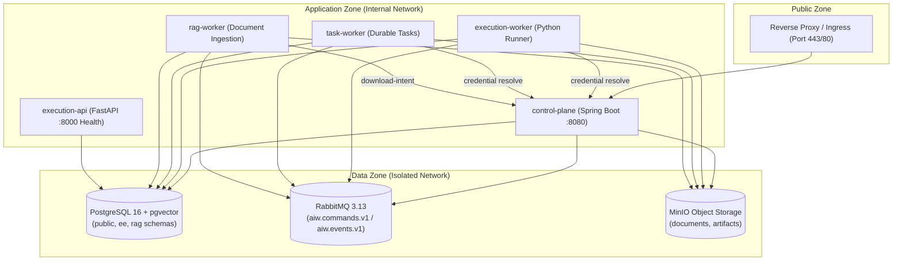
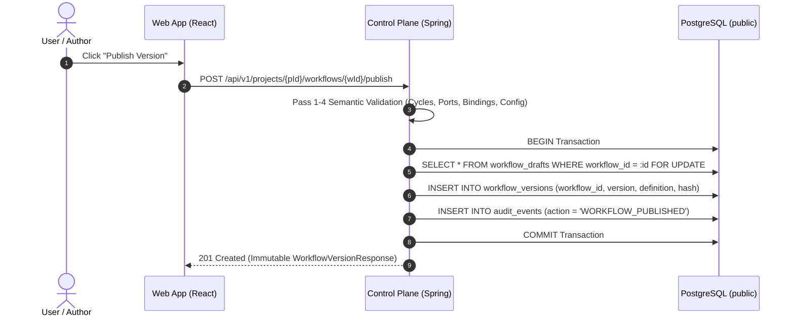
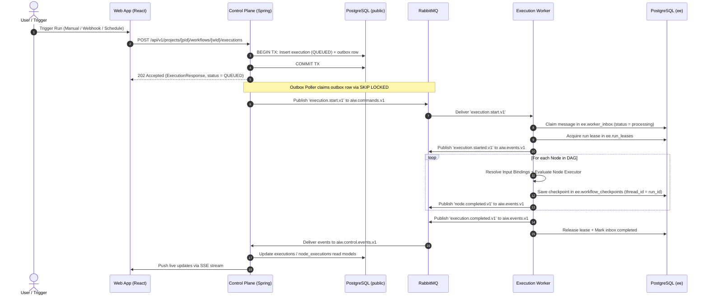
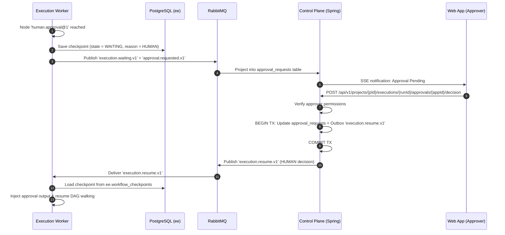
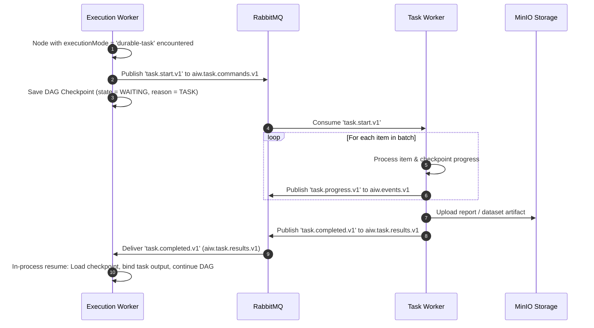

# AI Workflow Platform — High-Level Design (HLD)

## 1. Document Control

| Field | Value |
| --- | --- |
| **Document** | High-Level Design (HLD) |
| **System** | AI Workflow Platform |
| **Status** | Authoritative System Architecture Baseline |
| **Audience** | Full-stack, Java, Python, DevOps, and Security Engineers |
| **Contracts** | [`contracts/**`](../contracts/) (Canonical Wire Schemas) |
| **Service LLDs** | [`control-plane/LLD.md`](./control-plane/LLD.md), [`execution-engine/LLD.md`](./execution-engine/LLD.md), [`rag/README.md`](./rag/README.md) |

---

## 2. Executive Summary & Goals

The **AI Workflow Platform** enables authenticated users to visually compose, validate, publish, trigger, monitor, pause, and resume complex AI workflows. It combines deterministic control flow (conditions, bounded loops, fan-out/fan-in) with AI-driven operations (LLM chat, project-scoped RAG, durable heavy tasks, and human approval interrupts).

```
 ┌────────────────────────────────────────────────────────────────────────┐
 │                           React Web Browser                            │
 └───────────────────────────────────┬────────────────────────────────────┘
                                     │ HTTPS REST / SSE (/api/v1)
                                     ▼
 ┌────────────────────────────────────────────────────────────────────────┐
 │               Spring Boot Control Plane (Port 8080)                    │
 │    Identity, Drafts, Immutable Versions, Quartz, Outbox, Approvals     │
 └───────┬───────────────────────────┬────────────────────────────┬───────┘
         │                           │                            │
         ▼                           ▼                            ▼
 ┌───────────────┐           ┌───────────────┐            ┌───────────────┐
 │ PostgreSQL    │           │ RabbitMQ      │            │ MinIO Storage │
 │ public schema │           │ Exchanges     │            │ Source Docs   │
 └───────────────┘           └───────┬───────┘            └───────────────┘
                                     │
         ┌───────────────────────────┼────────────────────────────┐
         │ aiw.execution.commands    │ aiw.task.commands          │ aiw.ingestion.commands
         ▼                           ▼                            ▼
 ┌───────────────┐           ┌───────────────┐            ┌───────────────┐
 │ Execution     │           │ Task Worker   │            │ RAG Worker    │
 │ Worker (Py)   │           │ (Heavy Jobs)  │            │ (Ingest/Vect) │
 └───────┬───────┘           └───────┬───────┘            └───────┬───────┘
         │                           │                            │
         ▼                           ▼                            ▼
 ┌───────────────┐           ┌───────────────┐            ┌───────────────┐
 │ ee schema     │           │ MinIO Storage │            │ rag schema    │
 │ Checkpoints   │           │ Run Artifacts │            │ pgvector      │
 └───────────────┘           └───────────────┘            └───────────────┘
```

### 2.1 Core Architectural Principles (7 Golden Rules)

1. **Single Public Gateway:** Browsers communicate *exclusively* with the Spring Boot Control Plane over HTTPS (`/api/v1`, `/hooks/v1`). Python workers, databases, RabbitMQ, and MinIO are private.
2. **Contract-First Authority:** JSON Schemas in [`contracts/`](../contracts/) are canonical. Wire formats and manifest shapes must strictly adhere to them.
3. **Strict Schema Ownership:** Every service writes *only* to its owned database schema:
   - `public.*` &rarr; Owned exclusively by **Control Plane** (Spring Boot / Flyway).
   - `ee.*` &rarr; Owned exclusively by **Execution Engine** (`ee.workflow_checkpoints`, `ee.worker_inbox`, `ee.run_leases`).
   - `rag.*` &rarr; Owned exclusively by **RAG Service** (`rag.rag_document_versions`, `rag.rag_chunks`).
4. **Secrets by Reference:** Persisted workflow graphs and broker messages carry *credential IDs*, never secret values. Workers resolve credentials on-demand via the Control Plane against the run's frozen definition snapshot.
5. **At-Least-Once Delivery & Idempotency:** All RabbitMQ commands and event projectors use database-backed idempotency tables and transaction outbox/inbox guarantees.
6. **AST-Driven Control Flow:** Conditions use a validated Abstract Syntax Tree (AST); loops are explicit, bounded, and budgeted. No arbitrary code execution (`eval`/`exec`).
7. **Dual-Validation Defense:** Graphs are validated by both the Control Plane (pre-publish / pre-run) and the Execution Plane (pre-execution).

### 2.2 MVP Scope & Non-Goals

| Supported MVP Capabilities | Explicit MVP Non-Goals |
|---|---|
| • Visual DAG canvas with React Flow<br/>• Drafts & immutable published version pinning<br/>• Manual, Webhook, and Scheduled triggers<br/>• Conditional branches & bounded loops (`maxIterations`)<br/>• Hybrid wiring (edges + field-level input bindings)<br/>• Baseten Muse Spark chat & Gemini embeddings<br/>• Project-scoped document RAG via pgvector<br/>• Human approval/review durable pause & resume<br/>• Hardened outbound HTTP actions with SSRF filters<br/>• Durable heavy-task jobs (screening, research, cleanup)<br/>• Live SSE run tracing and checkpoint restart recovery | • Arbitrary user code execution (`eval`, Python scripts)<br/>• Runtime loading of untrusted binary/Python plug-ins<br/>• Public node marketplace<br/>• Real-time collaborative canvas editing<br/>• Billing, meter charging, or multi-tenant SaaS orgs<br/>• Enterprise SAML / OIDC federation (Argon2 / JWT used for MVP)<br/>• Automated brokerage trading or financial execution<br/>• Unrestricted host filesystem/cloud cleanup operations |

---

## 3. Container & Network Architecture



### 3.1 Service Responsibilities

| Service / Process | Tech Stack | Owns & Manages | Does NOT Own |
|---|---|---|---|
| **Control Plane** | Java 21 + Spring Boot | Public REST API, Identity, Workspaces/Projects, Workflow Drafts, Immutable Versions, Catalog Manifests, Credentials (encrypted), Triggers (Quartz), Outbox Publisher, SSE Run Projector, Approvals. | Graph walking, LLM calls, vector math, task execution. |
| **Execution Worker** | Python 3.12+ (Async) | Inbox idempotency, DAG walker runtime, step checkpoints, lease mutex, node executors, task command dispatch, run outcome events. | Public HTTP, user auth, platform user tables, document ingest. |
| **Task Worker** | Python 3.12+ (Async) | Long-running durable jobs (research, momentum screening, cleanup), per-item checkpoints, progress reporting, artifact generation. | Parent DAG orchestration, public APIs. |
| **RAG Worker** | Python 3.12+ (Async) | Document download, parsing, chunking, Gemini embeddings, `rag.*` vector storage, ingestion events. | Workflow graph execution, browser APIs. |
| **Execution API** | FastAPI + Uvicorn | Liveness (`/health`) and readiness (`/ready`) probes for container orchestration. | Workflow execution over HTTP. |

---

## 4. Cross-Service Interaction Flows

### 4.1 Workflow Publication Flow



---

### 4.2 Start and Execute Run Lifecycle



---

### 4.3 Human Approval / Review Interrupt Flow



---

### 4.4 Durable Heavy Task Execution Flow



---

## 5. Messaging Architecture & RabbitMQ Topology

RabbitMQ acts as the reliable, asynchronous transport between the Control Plane and Workers.

```
 Exchanges                  Routing Keys                       Queues
┌──────────────────┐       execution.*.v1                     ┌─────────────────────────────┐
│                  ├─────────────────────────────────────────►│ aiw.execution.commands.v1  │
│                  │       document.*.v1                      ├─────────────────────────────┤
│ aiw.commands.v1  ├─────────────────────────────────────────►│ aiw.ingestion.commands.v1  │
│ (Topic Exchange) │       task.start / task.cancel.v1        ├─────────────────────────────┤
│                  ├─────────────────────────────────────────►│ aiw.task.commands.v1       │
└──────────────────┘                                          └─────────────────────────────┘

┌──────────────────┐       task.completed / task.failed.v1    ┌─────────────────────────────┐
│ aiw.events.v1    ├─────────────────────────────────────────►│ aiw.task.results.v1         │
│ (Topic Exchange) │       *.v1 (all events)                  ├─────────────────────────────┤
│                  ├─────────────────────────────────────────►│ aiw.control.events.v1       │
└──────────────────┘                                          └─────────────────────────────┘

┌──────────────────┐       Exhausted retries / Corrupt        ┌─────────────────────────────┐
│ aiw.dead.v1 (DLX)├─────────────────────────────────────────►│ aiw.dead.letter.v1          │
└──────────────────┘                                          └─────────────────────────────┘
```

### 5.1 Command & Event Catalog

| Message Type | Exchange | Routing Key | Publisher | Consumer | Purpose |
|---|---|---|---|---|---|
| `execution.start` | `aiw.commands.v1` | `execution.start.v1` | Control Plane Outbox | Execution Worker | Start new run with frozen definition |
| `execution.cancel` | `aiw.commands.v1` | `execution.cancel.v1` | Control Plane Outbox | Execution Worker | Cooperative run cancellation |
| `execution.resume` | `aiw.commands.v1` | `execution.resume.v1` | Control Plane Outbox | Execution Worker | **HUMAN only** approval decision |
| `document.ingest` | `aiw.commands.v1` | `document.ingest.v1` | Control Plane Outbox | RAG Worker | Ingest document & index embeddings |
| `document.delete` | `aiw.commands.v1` | `document.delete.v1` | Control Plane Outbox | RAG Worker | Purge document chunks from `rag.*` |
| `task.start` | `aiw.commands.v1` | `task.start.v1` | **Execution Worker** | Task Worker | Start durable heavy task |
| `task.cancel` | `aiw.commands.v1` | `task.cancel.v1` | CP / Execution Worker | Task Worker | Cancel running heavy task |
| `task.completed` | `aiw.events.v1` | `task.completed.v1` | Task Worker | Execution Worker | Notify parent DAG to resume |
| `execution.*` | `aiw.events.v1` | `execution.*.v1` | Execution Worker | Control Plane | Lifecycle state (`started`, `completed`, `failed`) |
| `node.*` | `aiw.events.v1` | `node.*.v1` | Execution Worker | Control Plane | Node-level execution tracing |

### 5.2 Ack, Retry, and Dead-Letter Rules
1. **Never Ack Before State Write:** Consumers ack messages *only after* the local database transaction (inbox entry, checkpoint, or projection) has committed.
2. **Idempotent Side-Effects:** Node execution side-effects use stable idempotency keys: `run_id:node_id`. Retry attempts do *not* modify the key.
3. **DLQ Policy:** Poison pills (malformed JSON, schema mismatch, unauthorized tokens) are routed directly to `aiw.dead.v1` without infinite retries. Transient failures use exponential backoff with jitter.

---

## 6. Data Ownership & Database Architecture

```
 ┌───────────────────────────────────────────────────────────────────────────┐
 │                           PostgreSQL 16 Engine                            │
 ├───────────────────────────┬───────────────────────────┬───────────────────┤
 │   public schema           │   ee schema               │   rag schema      │
 │   (Control Plane Only)    │   (Execution Engine Only) │   (RAG Service)   │
 ├───────────────────────────┼───────────────────────────┼───────────────────┤
 │ • users, workspaces       │ • ee.workflow_checkpoints │ • rag_document_   │
 │ • projects, credentials   │ • ee.worker_inbox         │   versions        │
 │ • workflows, drafts       │ • ee.run_leases           │ • rag_chunks      │
 │ • workflow_versions       │ • ee.action_execution_keys│   (pgvector       │
 │ • executions, triggers    │ • ee.run_cancels          │    embeddings)    │
 │ • approval_requests       │ • ee.workflow_definitions │                   │
 │ • outbox_messages         │                           │                   │
 └───────────────────────────┴───────────────────────────┴───────────────────┘
```

### 6.1 Schema Isolation Matrix

| Data Domain | Schema / Storage | Writer / Authority | Readers |
|---|---|---|---|
| **Platform Records** | `public.*` | **Control Plane** (Flyway) | Control Plane (read/write) |
| **Durable Checkpoints** | `ee.workflow_checkpoints` | **Execution Worker** | Execution Worker (read/write) |
| **Worker Inbox / Mutex** | `ee.worker_inbox`, `ee.run_leases` | **Execution Worker** | Execution Worker |
| **Vector Chunks & Embeddings**| `rag.rag_chunks` | **RAG Worker** | RAG Worker (write), Execution Worker (read-only for `rag.retrieve@1`) |
| **Source Documents** | MinIO `documents/` bucket | **Client (via signed upload)** | RAG Worker (via download intent) |
| **Generated Artifacts** | MinIO `artifacts/` bucket | **Task / Execution Workers** | Control Plane (signed download API) |

### 6.2 Platform Execution State Machine

```
               ┌──────────┐
               │  QUEUED  │
               └────┬─────┘
                    │
                    ▼
               ┌──────────┐
        ┌─────►│ RUNNING  │◄────┐
        │      └────┬─────┘     │
        │           │           │
   Resume (HUMAN/   │ Suspend   │ Resume
   TASK complete)   ▼           │
             ┌───────────┐      │
             │  WAITING  ├──────┘
             └─────┬─────┘
                   │
    ┌──────────────┼──────────────┬──────────────┐
    ▼              ▼              ▼              ▼
┌───────────┐┌───────────┐┌───────────┐┌───────────┐
│ SUCCEEDED ││  FAILED   ││ CANCELLED ││ TIMED_OUT │
└───────────┘└───────────┘└───────────┘└───────────┘
```

---

## 7. Workflow Graph Wiring — Hybrid Model

The platform uses a **hybrid model**:
1. **Edges & Ports:** Govern DAG structure, dependencies, and execution control flow.
2. **Input Bindings:** Govern field-level data transformation between upstream outputs and downstream inputs.
3. **Catalog Default Bindings:** Provide zero-friction auto-wiring when standard nodes are connected.

```
┌──────────────────────────────────────────────────────────┐
│ 1. Catalog Port Manifests                                │
│    Defines named typed ports (e.g. 'prompt', 'text')     │
└────────────────────────────┬─────────────────────────────┘
                             ▼
┌──────────────────────────────────────────────────────────┐
│ 2. Workflow Structural Edges                             │
│    Declares dependency: source_node -> target_node       │
└────────────────────────────┬─────────────────────────────┘
                             ▼
┌──────────────────────────────────────────────────────────┐
│ 3. Target Node Input Bindings                            │
│    Maps fields: target_port.path <- source_node.port.path│
│    Origin: user | default | pass_through                 │
└────────────────────────────┬─────────────────────────────┘
                             ▼
┌──────────────────────────────────────────────────────────┐
│ 4. Execution Engine Runtime Resolver                     │
│    Resolves JSON Pointer paths & constructs input payload│
└──────────────────────────────────────────────────────────┘
```

### 7.1 Input Binding JSON Structure (On Target Node)

```json
{
  "id": "chat-node-uuid",
  "type": "ai.chat-model@1",
  "config": { "model": "gpt-4o" },
  "input_bindings": [
    {
      "target_port": "prompt",
      "target_path": "/text",
      "source_node_id": "prompt-template-uuid",
      "source_port": "text",
      "source_path": "/text",
      "origin": "default"
    }
  ]
}
```

- **Pass-through Shorthand:** If `input_bindings` is omitted or empty, the compiler infers whole-port 1:1 pass-through (`target_path: "/"`, `source_path: "/"`).
- **JSON Pointer Resolution:** Values are resolved using strict RFC 6901 JSON Pointers.

---

## 8. Security & Trust Boundaries

```
[Untrusted Internet]
        │ HTTPS (TLS 1.3) + Rate Limiting
        ▼
[Reverse Proxy / Ingress]
        │ Forward Authenticated Traffic
        ▼
[Spring Control Plane] (JWT Auth, RBAC, AES-256 GCM Credentials)
        │
        ├─► [Database] (Least privilege credentials per schema)
        ├─► [RabbitMQ] (Authenticated AMQP channels)
        └─► [Internal Network]
                │
                ▼
        [Python Execution Plane]
                │
                ├─► Pre-request DNS SSRF Validation (Blocks RFC 1918 / Metadata IPs)
                ├─► Secret Redaction Engine (Masks keys before logging/events)
                └─► Outbound Provider APIs (OpenAI, Webhooks, External HTTPS)
```

1. **SSRF Guard:** All outbound HTTP requests generated by user workflows undergo DNS pre-resolution and are validated against blocked IP ranges (`127.0.0.0/8`, `10.0.0.0/8`, `172.16.0.0/12`, `192.168.0.0/16`, `169.254.169.254`, `100.64.0.0/10`). Redirects are re-validated.
2. **Recursive Secret Redaction:** All node execution logs, event streams, and error envelopes pass through a recursive scanner that masks authorization headers, API keys, and sensitive tokens.
3. **No Dynamic Code Execution:** User workflows cannot run arbitrary Python/JS scripts. All compute occurs inside pre-compiled, sandboxed executor classes.
