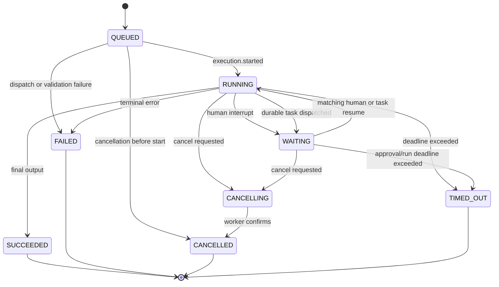

# AI Workflow Platform: Low-Level Design

## 1. Document Control

| Field | Value |
| --- | --- |
| Document | Low-Level Design (LLD) |
| System | AI Workflow Platform |
| Status | Initial implementation blueprint |
| Primary audience | Frontend, Java, Python, database, QA, and DevOps engineers |
| Related documents | `design/plan.md`, `design/HLD.md` |

This document translates the HLD into implementable modules, interfaces, endpoints, tables, events, validation rules, algorithms, and test boundaries. Names are proposed baselines and may be refined during implementation without changing the documented ownership rules or contracts.

## 2. Technical Baseline

| Layer | Technology |
| --- | --- |
| Web | React, TypeScript, Vite, React Router, TanStack Query, Zustand, React Flow, Lucide |
| Control plane | Java 21, Spring Boot, Spring MVC, Spring Security, Spring Data JPA, Flyway, Quartz, Spring AMQP |
| Execution plane | Python 3.13+, FastAPI, Pydantic, custom walker, async PostgreSQL, RabbitMQ client |
| Data | PostgreSQL, pgvector, MinIO |
| Test | Vitest/RTL/MSW, JUnit/Mockito/Testcontainers, pytest/respx/Testcontainers, Playwright |
| Packaging | Docker, Docker Compose, Maven Wrapper, npm, `uv` |

Exact dependency versions will be pinned when scaffolding and updated through controlled dependency automation.

## 3. Source Layout

```text
apps/web/src/
|-- api/generated/
|-- app/
|   |-- App.tsx
|   |-- router.tsx
|   `-- queryClient.ts
|-- components/
|-- features/
|   |-- auth/
|   |-- builder/
|   |   |-- canvas/
|   |   |-- conditions/
|   |   |-- inspector/
|   |   |-- nodes/
|   |   |-- validation/
|   |   `-- workflowEditorStore.ts
|   |-- credentials/
|   |-- datasets/
|   |-- projects/
|   |-- runs/
|   |-- triggers/
|   `-- workflows/
`-- test/

services/control-plane/src/main/java/com/example/aiworkflow/
|-- auth/
|-- catalog/
|-- common/
|-- credential/
|-- dataset/
|-- execution/
|-- approval/
|-- task/
|-- artifact/
|-- messaging/
|-- project/
|-- security/
|-- trigger/
|-- workflow/
`-- AiWorkflowApplication.java

services/execution-engine/src/ai_workflow/
|-- api/
|-- config/
|-- contracts/
|-- messaging/
|-- nodes/
|   |-- action/
|   |-- ai/
|   |-- control/
|   |-- human/
|   `-- rag/
|-- rag/
|-- runtime/
|-- security/
`-- worker/
```

## 4. Canonical Contract Design

### 4.1 Workflow Definition

Proposed logical TypeScript representation; JSON Schema remains canonical:

```ts
type WorkflowDefinition = {
  schemaVersion: "1.0";
  workflowId: string;
  workflowVersionId?: string;
  name: string;
  inputSchema: JsonSchema;
  outputSchema: JsonSchema;
  nodes: WorkflowNode[];
  edges: WorkflowEdge[];
  executionPolicy: ExecutionPolicy;
};

type WorkflowNode = {
  id: string;
  type: `${string}.${string}@${number}`;
  position: { x: number; y: number };
  config: Record<string, JsonValue>;
  credentialRefs?: Record<string, string>;
  resourceRefs?: Record<string, string>;
  inputBindings?: InputBinding[];
};

type InputBinding = {
  targetPort: string;
  targetPath: string;       // JSON Pointer; "/" = entire port value
  sourceNodeId: string;
  sourcePort: string;
  sourcePath: string;       // JSON Pointer; "/" = entire port value
  origin: "user" | "default" | "pass_through";
};

type WorkflowEdge = {
  id: string;
  sourceNodeId: string;
  sourcePort: string;
  targetNodeId: string;
  targetPort: string;
  label?: string;
  condition?: ConditionExpression;
};

type ExecutionPolicy = {
  timeoutSeconds: number;
  maxNodeExecutions: number;
  maxParallelNodes: number;
  maxFanOutItems: number;
  maxTaskSeconds: number;
  maxProviderCalls: number;
  maxArtifactBytes: number;
  maxEstimatedCost?: number;
  defaultRetry: RetryPolicy;
};
```

Constraints:

- IDs are UUID strings.
- Node IDs are unique within the graph.
- Edge IDs are unique within the graph.
- Node type major versions are explicit.
- `config` contains no credential values.
- `inputBindings` is optional; when omitted, the compiler infers whole-port pass-through from edges (see [05-workflow-wiring.md](./05-workflow-wiring.md)).
- Definition bytes, node count, edge count, and nesting depth are bounded.
- Unknown top-level fields are rejected for a major schema version.

### 4.2 Port Types

Each manifest port defines:

```json
{
  "name": "result",
  "direction": "output",
  "required": true,
  "cardinality": "single",
  "schema": { "type": "object" }
}
```

Compatibility rules:

1. Source and target ports must exist.
2. Direction must be output to input.
3. Cardinality must allow the proposed connection count.
4. Exact primitive types are compatible.
5. An object source is compatible when its guaranteed properties satisfy the target schema.
6. `any`/empty schema is allowed only on nodes explicitly designed for untyped JSON.
7. The server remains authoritative if client and server validators disagree.

### 4.2.1 Input bindings (hybrid wiring)

Edges declare **structure** (which nodes connect). Optional `input_bindings` on each node declare **field-level data flow**:

- `target_port` + `target_path` — where the value lands on the target input.
- `source_node_id` + `source_port` + `source_path` — where the value is read from upstream output.
- `origin` — `user` (explicit), `default` (catalog auto-fill), or `pass_through` (whole port at `/`).

When `input_bindings` is absent, validators and the compiler infer pass-through: each edge maps `source_port` at `/` → `target_port` at `/`.

Catalog input ports may declare optional `default_bindings` (e.g. `ai.chat-model@1` `prompt.text` ← upstream `text.text`). User bindings always override defaults.

Full rules, error codes, and examples: [05-workflow-wiring.md](./05-workflow-wiring.md).

### 4.3 Condition AST

```ts
type ConditionExpression =
  | { op: "all" | "any"; args: ConditionExpression[] }
  | { op: "not"; arg: ConditionExpression }
  | {
      op: "eq" | "ne" | "gt" | "gte" | "lt" | "lte" |
          "contains" | "startsWith" | "endsWith";
      left: Operand;
      right: Operand;
    }
  | { op: "exists" | "isNull"; value: Operand };

type Operand =
  | { kind: "path"; value: string }
  | { kind: "literal"; value: JsonValue };
```

Rules:

- State paths use a restricted JSON Pointer syntax.
- Maximum expression depth defaults to 10.
- `all` and `any` require 1 to 20 arguments.
- Comparison operators enforce compatible operand types.
- Missing paths produce a validation/evaluation result, not an exception leak.
- Conditions are evaluated without `eval`, dynamic imports, or template execution.

### 4.4 Loop Configuration

```json
{
  "maxIterations": 10,
  "exitCondition": {
    "op": "eq",
    "left": { "kind": "path", "value": "/loop/complete" },
    "right": { "kind": "literal", "value": true }
  }
}
```

Loop rules:

- `maxIterations` is required, integer, minimum 1, and cannot exceed the platform cap.
- The Loop node has `body` and `done` output ports.
- Back edges must target the Loop node's iteration input.
- The loop body cannot contain the workflow trigger.
- Nested loops are allowed only if enabled by policy and total node-execution budget remains finite.
- Reaching `maxIterations` routes to `done` with a limit-reached flag or fails according to explicit manifest policy; it never continues silently.

### 4.5 Node Manifest

```ts
type NodeManifest = {
  type: string;
  displayName: string;
  description: string;
  category: "trigger" | "data" | "control" | "ai" | "rag" | "human" | "action";
  executionOwner: "control-plane" | "execution-engine";
  inputs: PortDefinition[];
  outputs: PortDefinition[];
  configSchema: JsonSchema;
  credentialSlots: CredentialSlot[];
  resourceSlots: ResourceSlot[];
  capabilities: {
    retryable: boolean;
    cancellable: boolean;
    sideEffecting: boolean;
    executionMode: "inline" | "durable-task";
    emitsProgress: boolean;
    resumable: boolean;
  };
  ui: {
    icon: string;
    colorToken: string;
    inspector?: string;
  };
};
```

## 5. Frontend Detailed Design

### 5.1 Routes

| Route | View | Authorization |
| --- | --- | --- |
| `/login` | Login | Public |
| `/register` | Registration | Public |
| `/projects` | Project list | Authenticated |
| `/projects/:projectId/workflows` | Workflow list | Project member |
| `/projects/:projectId/workflows/:workflowId` | Workflow builder | Project member |
| `/projects/:projectId/runs` | Run history | Project member |
| `/projects/:projectId/runs/:runId` | Run inspector | Project member |
| `/projects/:projectId/datasets` | Dataset manager | Project member |
| `/projects/:projectId/credentials` | Credential manager | Project member |
| `/projects/:projectId/triggers` | Trigger manager | Project member |
| `/approvals` | Pending approvals | Authenticated and authorized per run |
| `/projects/:projectId/tasks/:taskId` | Heavy-task progress, items, budgets, and artifacts | Project member |

### 5.2 State Ownership

| State | Owner |
| --- | --- |
| Server entities and lists | TanStack Query |
| Access token and current identity | Auth provider in memory |
| Refresh token | Secure HTTP-only cookie, inaccessible to JavaScript |
| Canvas nodes, edges, selection, history | Zustand editor store |
| Form state | Local form library/component state |
| Run event projection | TanStack Query cache plus SSE reducer |
| Node catalog | Cached server query |

The editor store tracks `baseRevision`, `nodes`, `edges`, `selection`, `undoStack`, `redoStack`, and `dirty`. Server data is transformed into editor state once per loaded revision; background refetch must not overwrite dirty edits.

### 5.3 Builder Components

| Component | Responsibility |
| --- | --- |
| `WorkflowBuilder` | Load draft/catalog, compose toolbar, palette, canvas, inspector, and run panel |
| `BuilderToolbar` | Save, validate, publish, run, undo/redo, and viewport controls |
| `NodePalette` | Search and categorize manifest-backed nodes |
| `WorkflowCanvas` | React Flow integration and graph interactions |
| `ManifestNode` | Stable generic visual node shell |
| `ConditionEdge` | Labeled conditional edge rendering |
| `NodeInspector` | Resolve generic or specialized configuration editor |
| `SchemaForm` | Render supported JSON Schema fields |
| `ConditionBuilder` | Build the restricted condition AST |
| `ValidationPanel` | Group node, edge, and graph errors with focus actions |
| `RunPanel` | Show events, node details, outputs, cancellation, and approvals |

### 5.4 Save and Publish Behavior

1. Local changes update the editor store and undo history.
2. Debounced local validation provides immediate feedback.
3. Explicit Save sends the full normalized definition and `baseRevision`.
4. HTTP `409` indicates a revision conflict; the UI preserves local edits and offers reload/compare, not silent overwrite.
5. Publish first saves if needed, then calls the publish endpoint.
6. Server validation errors map to node/edge IDs and JSON Pointer paths.
7. A successful publication updates workflow/version queries but does not replace the editable draft.

### 5.5 SSE Client

- Connect to `/api/v1/projects/{projectId}/executions/{runId}/events`.
- Send `Last-Event-ID` automatically on reconnect.
- Deduplicate events by event ID.
- Apply only events with sequence greater than the projected sequence.
- Backfill through REST when the server reports a replay gap.
- Exponentially reconnect with an upper bound and visible connection state.
- Stop after a terminal run event and a final read-model refresh.

## 6. Spring Boot Detailed Design

### 6.1 Package Pattern

Each feature package follows a small vertical slice:

```text
workflow/
|-- api/          controllers and request/response DTOs
|-- application/  use cases and transactions
|-- domain/       entities, value objects, policies, and domain errors
`-- persistence/  JPA entities, repositories, and mappers
```

Cross-cutting modules:

- `common.problem`: RFC 9457-style problem responses.
- `common.ids`: UUID parsing and strongly named identifiers where useful.
- `common.time`: injected `Clock`.
- `security`: filter chain, JWT verification, principals, and method authorization.
- `messaging`: outbox publisher, event listener, envelope validation, and inbox deduplication.

### 6.2 Key Application Services

| Service | Responsibilities |
| --- | --- |
| `AuthService` | Register, authenticate, issue/rotate/revoke sessions |
| `ProjectService` | Project CRUD and membership checks |
| `WorkflowDraftService` | Create, load, update, and revision-check drafts |
| `WorkflowValidationService` | Schema, manifest, graph, resource, and policy validation |
| `WorkflowPublicationService` | Validate and atomically create immutable versions |
| `NodeCatalogService` | Load and expose supported manifests |
| `CredentialService` | Encrypt, mask, rotate metadata, and resolve run-scoped credentials |
| `DatasetService` | Dataset/document metadata and signed object operations |
| `TaskJobService` | Project durable-task progress, item summaries, cancellation, and artifact access |
| `AuditService` | Auth/publish/credential/trigger/run/approval audit rows |
| `ArtifactService` | Authorize signed artifact **download** (workers write objects) |
| `TriggerService` | Manual/webhook/schedule lifecycle and published-version pinning |
| `ExecutionService` | Create, cancel, and query executions |
| `ApprovalService` | Authorize and resolve pending approvals |
| `ExecutionEventProjector` | Idempotently project worker events into read models |
| `OutboxPublisher` | Claim, publish, confirm, and mark outbox messages |

### 6.3 Public REST API

All endpoints are under `/api/v1`. Responses use JSON unless stated otherwise.

#### Authentication

| Method | Path | Behavior |
| --- | --- | --- |
| `POST` | `/auth/register` | Create account and personal workspace; return access token and set refresh cookie |
| `POST` | `/auth/login` | Authenticate; return access token and set refresh cookie |
| `POST` | `/auth/refresh` | Rotate refresh token and return access token |
| `POST` | `/auth/logout` | Revoke current refresh token family/member and clear cookie |
| `GET` | `/auth/me` | Return current user and workspace context |

#### Projects and Workflows

| Method | Path | Behavior |
| --- | --- | --- |
| `GET` | `/projects` | List authorized projects with cursor pagination |
| `POST` | `/projects` | Create project |
| `GET` | `/projects/{projectId}` | Get project |
| `PATCH` | `/projects/{projectId}` | Update project metadata |
| `GET` | `/projects/{projectId}/workflows` | List workflows |
| `POST` | `/projects/{projectId}/workflows` | Create workflow and initial draft |
| `GET` | `/projects/{projectId}/workflows/{workflowId}` | Get workflow summary |
| `GET` | `/projects/{projectId}/workflows/{workflowId}/draft` | Get mutable draft and revision |
| `PUT` | `/projects/{projectId}/workflows/{workflowId}/draft` | Replace draft if revision matches |
| `POST` | `/projects/{projectId}/workflows/{workflowId}/validate` | Run authoritative validation |
| `POST` | `/projects/{projectId}/workflows/{workflowId}/publish` | Create next immutable version |
| `GET` | `/projects/{projectId}/workflows/{workflowId}/versions` | List published versions |
| `GET` | `/projects/{projectId}/workflows/{workflowId}/versions/{version}` | Get published version |
| `GET` | `/node-catalog` | Return supported node manifests |

#### Credentials and Datasets

| Method | Path | Behavior |
| --- | --- | --- |
| `GET` | `/projects/{projectId}/credentials` | List masked credential metadata |
| `POST` | `/projects/{projectId}/credentials` | Encrypt and create credential |
| `PUT` | `/projects/{projectId}/credentials/{credentialId}` | Replace encrypted secret and metadata |
| `DELETE` | `/projects/{projectId}/credentials/{credentialId}` | Delete if not protected by policy/reference |
| `GET` | `/projects/{projectId}/datasets` | List datasets |
| `POST` | `/projects/{projectId}/datasets` | Create dataset |
| `POST` | `/projects/{projectId}/datasets/{datasetId}/documents/uploads` | Create signed upload intent |
| `POST` | `/projects/{projectId}/datasets/{datasetId}/documents` | Confirm upload and queue ingestion |
| `GET` | `/projects/{projectId}/datasets/{datasetId}/documents` | List documents and ingestion state |
| `DELETE` | `/projects/{projectId}/datasets/{datasetId}/documents/{documentId}` | Queue deletion and mark deleting |

#### Triggers, Executions, and Approvals

| Method | Path | Behavior |
| --- | --- | --- |
| `GET` | `/projects/{projectId}/workflows/{workflowId}/triggers` | List triggers |
| `POST` | `/projects/{projectId}/workflows/{workflowId}/triggers` | Create trigger pinned to a version |
| `PATCH` | `/projects/{projectId}/workflows/{workflowId}/triggers/{triggerId}` | Activate/deactivate or repin trigger |
| `DELETE` | `/projects/{projectId}/workflows/{workflowId}/triggers/{triggerId}` | Delete trigger |
| `POST` | `/projects/{projectId}/workflows/{workflowId}/executions` | Start draft test or published execution |
| `GET` | `/projects/{projectId}/executions` | List executions with filters/cursor |
| `GET` | `/projects/{projectId}/executions/{runId}` | Get run and node read model |
| `POST` | `/projects/{projectId}/executions/{runId}/cancel` | Request cancellation |
| `GET` | `/projects/{projectId}/executions/{runId}/events` | Authenticated SSE with replay |
| `GET` | `/projects/{projectId}/executions/{runId}/tasks` | List durable tasks and progress for a run |
| `GET` | `/projects/{projectId}/tasks/{taskId}` | Get task status, budgets, warnings, and item summary |
| `GET` | `/projects/{projectId}/tasks/{taskId}/items` | Cursor-page safe per-item outcomes |
| `POST` | `/projects/{projectId}/tasks/{taskId}/cancel` | Request task and parent-run cancellation |
| `GET` | `/projects/{projectId}/artifacts/{artifactId}/download` | Return a short-lived authorized artifact download |
| `GET` | `/approvals` | List approvals authorized for current user |
| `POST` | `/projects/{projectId}/executions/{runId}/approvals/{approvalId}/decision` | Approve, reject, or edit and queue resume |

#### Webhook

| Method | Path | Behavior |
| --- | --- | --- |
| `POST` | `/hooks/v1/{triggerPublicId}/{secret}` | Validate active trigger and input, then create a pinned run |

### 6.4 Internal API

Internal endpoints are not exposed by the public proxy and require service authentication.

| Method | Path | Behavior |
| --- | --- | --- |
| `POST` | `/internal/v1/executions/{runId}/credentials:resolve` | Resolve declared credential slots for one run/node |
| `POST` | `/internal/v1/documents/{documentId}/download-intent` | Return short-lived authorized object read data |
| `GET` | `/actuator/health/liveness` | Process liveness |
| `GET` | `/actuator/health/readiness` | Dependency readiness |

Credential resolution request includes camelCase `nodeId`, requested slot names, optional `workflowVersionId` (null for draft runs), and a short-lived service assertion. Spring verifies that the **run’s frozen definition** declares each slot before decrypting.

### 6.5 Error Model

```json
{
  "type": "https://errors.example.dev/workflow-validation",
  "title": "Workflow validation failed",
  "status": 422,
  "code": "WORKFLOW_INVALID",
  "correlationId": "uuid",
  "errors": [
    {
      "code": "PORT_INCOMPATIBLE",
      "path": "/edges/2",
      "nodeId": null,
      "edgeId": "uuid",
      "message": "Output 'text' is not compatible with input 'documents'"
    },
    {
      "code": "BINDING_MISSING",
      "path": "/nodes/3/input_bindings",
      "nodeId": "uuid",
      "message": "Required input port 'prompt' has no binding or pass-through"
    }
  ]
}
```

Messages are safe for users and contain no stack traces, SQL text, secrets, or internal network details.

## 7. Platform Database Design

All tables include `created_at`; mutable tables include `updated_at`. UUIDs are generated server-side. JSONB columns are validated by application contracts and bounded in size.

### 7.1 Identity and Tenancy

| Table | Important columns | Constraints and indexes |
| --- | --- | --- |
| `users` | `id`, `email_normalized`, `password_hash`, `status`, `display_name` | Unique email; status index |
| `workspaces` | `id`, `name`, `kind`, `owner_user_id` | Owner FK; personal owner unique |
| `workspace_memberships` | `workspace_id`, `user_id`, `role` | Composite PK; user index |
| `projects` | `id`, `workspace_id`, `name`, `description`, `archived_at` | Workspace/name index |
| `refresh_tokens` | `id`, `user_id`, `family_id`, `token_hash`, `expires_at`, `revoked_at`, `replaced_by_id` | Unique hash; family and expiry indexes |

### 7.2 Workflow Design

| Table | Important columns | Constraints and indexes |
| --- | --- | --- |
| `workflows` | `id`, `workspace_id`, `project_id`, `name`, `description`, `latest_version` | Project/name index |
| `workflow_drafts` | `workflow_id`, `revision`, `definition_json`, `updated_by` | Workflow PK; positive revision |
| `workflow_versions` | `id`, `workflow_id`, `version_number`, `definition_json`, `definition_hash`, `published_by`, `published_at` | Unique workflow/version; immutable by service policy |

Draft update SQL uses `WHERE workflow_id = ? AND revision = ?`, increments revision, and returns conflict when no row updates. Publication locks the workflow row, validates the current draft, increments `latest_version`, and inserts the version in one transaction.

### 7.3 Credentials and Triggers

| Table | Important columns | Constraints and indexes |
| --- | --- | --- |
| `credentials` | `id`, `workspace_id`, `project_id`, `type`, `name`, `ciphertext`, `nonce`, `key_id`, `masked_hint` | Project/type index; unique project/name |
| `triggers` | `id`, `workflow_id`, `workflow_version_id`, `type`, `name`, `status`, `config_json`, `public_id`, `secret_hash` | Public ID unique; active/status indexes |

Schedule configuration stores normalized timezone, schedule expression, and misfire policy. Quartz JDBC tables store next-fire state; application trigger records remain authoritative for activation and version pinning.

### 7.4 Datasets

| Table | Important columns | Constraints and indexes |
| --- | --- | --- |
| `datasets` | `id`, `workspace_id`, `project_id`, `name`, `embedding_config_json` | Project/name unique |
| `documents` | `id`, `dataset_id`, `object_key`, `original_name`, `media_type`, `size_bytes`, `content_hash`, `version`, `status`, `error_code` | Dataset/status index; content/version uniqueness policy |

### 7.5 Executions

| Table | Important columns | Constraints and indexes |
| --- | --- | --- |
| `executions` | `id`, ownership IDs, `workflow_id`, `workflow_version_id`, `mode`, `status`, `input_json`, `output_json`, `last_sequence`, timestamps, `error_code` | Project/created index; status/updated index |
| `node_executions` | `id`, `execution_id`, `node_id`, `attempt`, `status`, input/output/error JSON, timing, token/cost fields | Unique run/node/attempt; run/status index |
| `execution_events` | `id`, `execution_id`, `sequence`, `event_type`, `payload_json`, `occurred_at` | Unique run/sequence and message ID; replay index |
| `approval_requests` | `id`, `execution_id`, `node_id`, `interrupt_id`, `status`, `request_json`, `decision_json`, resolved metadata | Unique interrupt ID; pending index |
| `task_jobs` | `id`, `execution_id`, `node_id`, `task_type`, `status`, `waiting_reason`, progress counters, budget/usage JSON, checkpoint cursor, timestamps | Unique run/node/task key; status/progress index |
| `task_items` | `id`, `task_job_id`, `item_key`, `status`, `attempt`, result/error summary, timestamps | Unique task/item key; task/status index |
| `artifacts` | `id`, ownership IDs, `execution_id`, `task_job_id`, `kind`, `object_key`, `media_type`, `size_bytes`, `sha256`, retention metadata | Project/time and task indexes; unique object key |
| `audit_events` | actor/ownership IDs, `action`, `resource_type`, `resource_id`, `details_json`, timestamp | Workspace/time and resource indexes |

Large node payloads are truncated or externalized according to policy. The read model stores redacted values only.

### 7.6 Messaging Tables

| Table | Important columns | Constraints and indexes |
| --- | --- | --- |
| `outbox_messages` | `id`, `aggregate_type`, `aggregate_id`, `message_type`, `payload_json`, `status`, `attempts`, `available_at`, `published_at` | Status/available index |
| `consumed_messages` | `consumer_name`, `message_id`, `consumed_at` | Composite PK; retention index |

The publisher claims rows with `FOR UPDATE SKIP LOCKED`, publishes with confirms, and marks success. Failed attempts update `available_at` with bounded backoff.

## 8. Authentication and Security Implementation

### 8.1 Access and Refresh Tokens

- Access JWT lifetime: proposed 10 minutes, configurable.
- Refresh token lifetime: proposed 30 days, configurable.
- Access JWT contains subject, token ID, roles, issued/expiry times; resource ownership is loaded/verified server-side.
- Refresh token is 256-bit random data in a secure, HTTP-only, same-site cookie.
- Refresh tokens are hashed with a keyed or password-safe hash before storage.
- Rotation creates a successor and marks the predecessor replaced in one transaction.
- Reuse of a replaced/revoked token revokes the entire family and records an audit event.

### 8.2 Credential Encryption

Envelope fields:

- `ciphertext`
- unique `nonce`
- `key_id`
- authenticated context containing credential ID, workspace ID, project ID, and credential type

Decryption is available only inside `CredentialService`. Plaintext is held only for the internal response lifetime, excluded from object string representations, and never cached in shared application caches.

### 8.3 Service Authentication

Initial Compose implementation may use short-lived signed service JWTs over the private network. Hosted environments should use mTLS or workload identity. Assertions include caller service, audience, issued/expiry times, request correlation ID, and run ID where applicable.

## 9. Workflow Validation Design

### 9.1 Validation Stages

Validation returns all practical errors in deterministic order:

1. Parse and enforce payload byte limit.
2. Validate canonical JSON Schema.
3. Check unique node and edge IDs.
4. Resolve each node manifest and exact major version.
5. Validate node config, credential slots, and resource slots.
6. Validate edge endpoints, directions, cardinality, and port schemas.
7. Validate input bindings (required ports bound, reachable sources, path/type compatibility) or infer pass-through from edges.
8. Exactly one Input/start node plus reachability and Output reachable (platform webhook/schedule are not graph trigger nodes).
9. Validate structured conditions and mutually understandable branch labels.
10. Detect strongly connected components and enforce explicit Loop ownership.
11. Enforce graph, loop, nesting, and execution-policy limits.
12. Resolve referenced credentials/datasets within project ownership for publication.

### 9.2 Cycle Validation Algorithm

Use Tarjan's strongly connected components algorithm in `O(V + E)`:

1. Build adjacency from node IDs and edges.
2. Find strongly connected components (SCCs).
3. Ignore a singleton SCC without a self-edge.
4. For each cyclic SCC, require exactly one controlling `control.loop@1` node unless nested-loop policy explicitly permits more.
5. Require every edge entering the next iteration to target the Loop iteration port.
6. Remove permitted loop-back edges and verify the remaining graph is acyclic.
7. Verify all nodes in the loop body can reach either the Loop node or an allowed failure terminal.
8. Emit stable error codes and edge/node paths for each violation.

### 9.3 Reachability

- A runnable graph has exactly one Input/start node. Platform webhook/schedule triggers are not graph nodes.
- Every other node must be reachable from start unless explicitly marked disabled in a future schema.
- At least one Output node must be reachable.
- Every Condition output declared by the manifest must be connected or explicitly configured as terminal/optional.
- Unreachable nodes are publication errors, not warnings, in the MVP.

## 10. Execution Engine Detailed Design

**Authoritative:** [execution-engine/LLD.md](./execution-engine/LLD.md) (as-built + locked Target). This section is a short index; do not extend it independently.

The runtime is a custom **interpreter/walker** with a PostgreSQL checkpointer (`thread_id = run_id`). It does not compile a LangGraph `StateGraph`. In-process **WorkflowIR** is cached by `definition_hash`. Resume ownership, leases, for-each body rules, and checkpoint envelope versioning are locked in the service LLD.

### 10.1 Core Protocols

```python
class NodeExecutor(Protocol):
    node_type: str

    async def execute(
        self,
        context: ExecutionContext,
        config: dict[str, JsonValue],
        inputs: dict[str, JsonValue],
    ) -> NodeResult: ...


class CredentialResolver(Protocol):
    async def resolve(
        self, run_id: UUID, node_id: UUID, slots: list[str]
    ) -> dict[str, SecretValue]: ...


class EventPublisher(Protocol):
    async def publish(self, event: ExecutionEvent) -> None: ...


class DurableTaskExecutor(Protocol):
  task_type: str

  async def run(
    self,
    context: TaskContext,
    payload: dict[str, JsonValue],
    checkpoint: TaskCheckpoint | None,
  ) -> TaskResult: ...
```

`ExecutionContext` contains run/workspace/project/workflow-version IDs, node ID, attempt, cancellation token, deadline, idempotency key, provider clients, and redacting logger. It does not expose arbitrary database sessions to node executors.

`TaskContext` additionally exposes bounded progress reporting, item checkpoint storage, artifact writing, and budget consumption. It does not provide shell access, host filesystem paths, or unrestricted cloud/database clients.

### 10.2 Registry

`NodeRegistry` maps exact `type@majorVersion` keys to:

- Parsed manifest.
- Config/input/output Pydantic models.
- Parsed `default_bindings` per input port (catalog hints).
- Executor factory.
- Optional `ControlFlowHandler` for for-each / durable dispatch (not a graph compiler). `control.loop@1` is a normal node.

Startup fails if:

- Two executors claim the same type/version.
- An executor lacks a manifest.
- A manifest-owned runtime node lacks an executor.
- Schemas cannot compile.

### 10.3 Walker and WorkflowIR

See [execution-engine/LLD.md](./execution-engine/LLD.md) §7. Validate → persist definition by hash → walk ready nodes → checkpoint versioned envelope. Durable-task nodes dispatch `task.start` and interrupt `TASK`. Human nodes interrupt `HUMAN`. Only `execution.resume` continues the walker.

### 10.4 Runtime State

```python
class WorkflowState(TypedDict):
    values: dict[str, JsonValue]
    node_outputs: dict[str, dict[str, JsonValue]]
    loop_iterations: dict[str, int]
  task_refs: dict[str, str]
    runtime: RuntimeMetadata
```

State updates are namespaced by node ID to prevent accidental field collisions. Edge input bindings read from `node_outputs[source_node_id][source_port]` at `source_path` and write to the target input at `target_path`. When `input_bindings` is omitted, whole-port pass-through applies. State/event payload size limits are checked after each node.

### 10.5 Command Handling

For `execution.start`:

1. Validate envelope and schema version.
2. Insert/check worker inbox record by message ID.
3. Validate immutable workflow and input.
4. Emit `execution.started` with sequence allocation.
5. Compile or load graph by definition hash.
6. Invoke `stream_events` with `thread_id = run_id`.
7. Translate walker node hooks to platform events.
8. On interrupt, emit `execution.waiting` and acknowledge command.
9. On completion/failure/cancellation, emit the terminal event.
10. Commit inbox state and acknowledge only after durable checkpoint/event obligations are met.

For `execution.resume`:

1. Verify run/thread ID and unresolved interrupt ID.
2. Deduplicate decision command.
3. Call `resume_workflow` with the decision and the same thread ID (`run_id`).
4. Continue event translation until waiting or terminal.

For a durable-task node:

1. Derive a stable task ID from run ID, node ID, and node execution ordinal.
2. Publish `task.start` with typed payload, policy limits, and no plaintext credentials.
3. Persist the task reference in the walker checkpoint and enter `WAITING` with reason `TASK`.
4. A task worker claims bounded items, saves per-item checkpoints, emits progress, and writes large outputs as artifacts.
5. `task.completed` or `task.failed` is consumed by the execution coordinator.
6. The coordinator verifies task/run/node identity and resumes the same walker thread with a typed result or failure.
7. Duplicate task completion events are ignored after the task reference is resolved.

### 10.6 Cancellation

- Spring transitions `RUNNING` or `WAITING` to `CANCELLING` and emits `execution.cancel`.
- Worker cancellation registry marks the run cancelled.
- Node adapters check cancellation before invocation and after awaited provider calls.
- HTTP/provider clients receive cancellation where supported.
- A cancelled graph emits `execution.cancelled`; Spring transitions to `CANCELLED`.
- If cancellation cannot interrupt an external request, the result is discarded and no downstream node runs.
- Cancelling a parent run publishes `task.cancel` for every active child task; task workers stop between items and at cancellable provider awaits.

### 10.7 Event Sequencing

Each active run has a single logical sequence allocator in the worker execution context. Sequence starts at 1 and increments for every platform event. Resume obtains the latest persisted sequence from checkpoint/runtime metadata. Spring enforces unique `(execution_id, sequence)` and can detect gaps for reconciliation.

## 11. Starter Node Specifications

### 11.1 Input

- Type: `data.input@1`
- Input ports: none.
- Output: `value`, validated against workflow input schema.
- Side effects: none.

### 11.2 Output

- Type: `data.output@1`
- Input: mapped `value`.
- Output ports: none.
- Behavior: validates and writes final workflow output.

### 11.3 Condition

- Type: `control.condition@1`
- Input: `value` or state paths.
- Outputs: named branches, initially `true` and `false`.
- Config: condition AST.
- Behavior: pure deterministic evaluation.

### 11.4 Merge

- Type: `control.merge@1`
- Inputs: manifest-configured branch inputs.
- Output: mapped object.
- Config: explicit field mappings and merge policy.
- Conflict policy: reject duplicate target fields unless an explicit reducer is selected.
- **Note:** Merge `config.mappings` remains the MVP fan-in mechanism; field-level `input_bindings` on other nodes handle most upstream→downstream wiring. Convergence of Merge with bindings is a later phase ([05-workflow-wiring.md](./05-workflow-wiring.md) §10).

### 11.5 Loop

- Type: `control.loop@1`
- Input: `iteration` plus optional initial value.
- Outputs: `body` and `done`.
- Config: `maxIterations`, exit condition, and limit behavior.
- Runtime: increments a node-scoped counter before body dispatch and checks run budget.

### 11.6 Prompt Template

- Type: `ai.prompt-template@1`
- Input: named variables.
- Output: rendered text.
- Template syntax supports substitutions only; no function calls, imports, or arbitrary expressions.
- Missing required variables fail validation/execution with a safe error.

### 11.7 Chat Model

- Type: `ai.chat-model@1`
- Inputs: messages/prompt and optional structured response schema.
- Output: text/message plus usage metadata.
- Credential slot: `provider`.
- Config: base URL reference policy, model, temperature, maximum output tokens, timeout.
- Retry: rate limit and selected transient provider errors only.

### 11.8 RAG Retrieve

- Type: `rag.retrieve@1`
- Input: query text.
- Output: ordered document chunks with safe metadata and scores.
- Resource slot: dataset ID.
- Config: top K, optional score threshold, metadata filters from an allowlist.
- Query always includes workspace/project/dataset/document-active predicates.

### 11.9 Approval and Review

- Types: `human.approval@1`, `human.review@1`.
- Input: JSON-serializable request content.
- Output: decision or edited value.
- Exactly one deterministic interrupt per invocation.
- Approval payload and allowed response schema are persisted in the platform event.

### 11.10 HTTP Request

- Type: `action.http-request@1`
- Inputs: URL variables, headers, query, and body.
- Output: status, allowlisted headers, and bounded response body.
- Credential slots: optional header/query auth references.
- Methods: allowlisted set, initially GET/POST/PUT/PATCH/DELETE.
- Security: scheme allowlist, DNS/IP checks, private-network deny, redirect revalidation, timeout, size limit, and redaction.
- Idempotency: send stable idempotency header where configured; persist action execution key/result before downstream continuation.

### 11.11 For Each and Collect

- Types: `control.for-each@1`, `control.collect@1`.
- For Each input: bounded JSON array and item subflow mapping.
- Config: `maxItems`, `concurrency`, item timeout, ordering, and `failFast`/`continue` policy.
- Runtime: assigns a stable item key from index plus canonical item hash and never exceeds workflow/platform fan-out limits.
- Collect output: ordered successes, failures, skipped items, summary counts, and optional artifact reference when output exceeds state limits.
- For Each is control flow, not an escape hatch for arbitrary code.

### 11.12 Market Data

- Type: `market.price-history@1`.
- Input: bounded normalized symbol list or project watchlist resource.
- Output: adjusted OHLCV series plus exchange, currency, provider, timezone, coverage, and `asOf` metadata.
- Credential slot: `marketDataProvider`.
- Config: date range, interval, adjusted/unadjusted policy, and missing-data behavior.
- Symbols, dates, and returned series are validated; stale or incomplete data generates visible warnings or fails according to policy.

### 11.13 Momentum Screen

- Type: `market.momentum-screen@1`.
- Input: validated market-data output.
- Output: ranked candidates with every factor, normalized factor value, weighted score, rank, exclusions, warnings, formula version, and `asOf` timestamp.
- Config: lookback windows, factor weights, minimum history/liquidity, volatility penalty, benchmark/reference series, top N, and tie policy.
- Calculation is deterministic decimal/numeric code, not an LLM prompt.
- Formula configuration and input-data hash are persisted for reproducibility.
- Node cannot submit orders; outputs are labeled informational and require downstream approval for any future brokerage integration.

### 11.14 Deep Research

- Type: `research.deep-research@1`.
- Execution mode: `durable-task`.
- Input: research question, scope, optional seed sources, and required output schema.
- Credential/resource slots: search provider, model provider, optional authorized project corpus.
- Config: allowed domains/source types, maximum sources, depth, elapsed time, tokens, provider calls, estimated cost, and report format.
- Output: artifact reference, executive summary, source manifest, citation coverage, unsupported-claim warnings, usage, and completion reason.
- Worker captures canonical URL/source ID, title, publisher, retrieval timestamp, content hash, and cited excerpts permitted by policy.
- Generated claims must map to source IDs; reports distinguish direct evidence, inference, and unresolved questions.

### 11.15 Cleanup Plan and Execute

- Types: `action.cleanup-plan@1`, `action.cleanup-execute@1`.
- Execution mode: `durable-task` for non-trivial inventories/execution.
- Connectors are typed and allowlisted, initially limited to platform-managed datasets, generated artifacts, expired run data, or explicitly added external connectors.
- Plan input/config defines exact resource scope, age/status filters, action (`archive`, `quarantine`, or `delete`), item/byte caps, and exclusions.
- Plan output includes immutable plan ID/hash, item identities, observed versions/ETags, estimated reclaimed bytes, irreversible-item warnings, and expiry.
- Execute requires the unchanged plan hash and an approval decision; it revalidates resource ownership, versions, caps, and exclusions before mutation.
- Each item uses a stable idempotency key and records succeeded, skipped-precondition, failed, and rollback metadata.
- Generic shell commands, arbitrary SQL, undeclared paths, and host filesystem traversal are prohibited.

## 12. Messaging Design

### 12.1 Topology

| Entity | Name | Purpose |
| --- | --- | --- |
| Topic exchange | `aiw.commands.v1` | Execution and ingestion commands |
| Topic exchange | `aiw.events.v1` | Execution and ingestion events |
| Queue | `aiw.execution.commands.v1` | Start/resume/cancel commands |
| Queue | `aiw.ingestion.commands.v1` | Document ingest/delete commands |
| Queue | `aiw.task.commands.v1` | Heavy task start/cancel commands |
| Queue | `aiw.task.results.v1` | Task completion consumed by execution coordinator |
| Queue | `aiw.control.events.v1` | Events consumed by Spring |
| Dead-letter exchange | `aiw.dead.v1` | Exhausted/invalid message routing |

Routing keys use exact versioned forms such as `execution.start.v1`, `execution.node.completed.v1`, and `document.ingest.v1`.

Heavy-task routing keys add `task.start.v1`, `task.cancel.v1`, `task.progress.v1`, `task.item.completed.v1`, `task.completed.v1`, and `task.failed.v1`. Progress events are coalesced/rate-limited; item events may store only summaries when a job is large.

### 12.2 Envelope

```json
{
  "messageId": "uuid",
  "messageType": "execution.start",
  "schemaVersion": "1.0",
  "occurredAt": "2026-07-24T12:00:00Z",
  "correlationId": "uuid",
  "causationId": "uuid",
  "idempotencyKey": "string",
  "tenant": {
    "workspaceId": "uuid",
    "projectId": "uuid"
  },
  "subject": {
    "workflowId": "uuid",
    "workflowVersionId": "uuid",
    "runId": "uuid"
  },
  "sequence": null,
  "payload": {}
}
```

Start payload contains the immutable definition or a content-addressed internal reference plus validated input and run policy. For the MVP, embedding the bounded immutable definition avoids a worker callback dependency; credentials remain references.

### 12.3 Retry and Dead Letter

- Consumer retry uses delayed queues or delayed-message exchange where available.
- Retry headers include attempt and next eligible time.
- Maximum attempts are message-type specific.
- Schema failures, authorization/reference failures, and unsupported versions go directly to dead letter.
- Dead-letter payloads preserve IDs and safe error codes but redact source payload fields classified sensitive.

## 13. Execution State Machine



Transition application checks current state and event sequence in one transaction. Duplicate events are no-ops. Invalid transitions are quarantined for reconciliation rather than forcing state.

`WAITING` carries `waitingReason = HUMAN | TASK`. A human decision cannot resume a task wait, and a task result cannot resume a human wait. Task jobs independently use `QUEUED`, `RUNNING`, `SUCCEEDED`, `FAILED`, `CANCELLING`, `CANCELLED`, and `TIMED_OUT`.

## 14. RAG Detailed Design

### 14.1 Vector Tables

| Table | Important columns |
| --- | --- |
| `rag_document_versions` | workspace/project/dataset/document IDs, version, content hash, status, chunking/embedding config hash |
| `rag_chunks` | document-version ID, chunk index, text, token count, metadata JSONB, embedding vector |

Indexes:

- Ownership B-tree index on workspace/project/dataset/document-version.
- Unique document-version/chunk-index.
- pgvector HNSW or IVFFlat index selected after representative data tests.
- Optional metadata GIN index only for supported filters.

### 14.2 Ingestion Pipeline

1. Validate command and deduplicate by document/version/content hash.
2. Obtain a short-lived download intent from Spring.
3. Stream object with byte limit and hash verification.
4. Select extractor from an allowlist of supported MIME types.
5. Normalize text deterministically.
6. Chunk using versioned chunking configuration.
7. Batch embedding requests with timeout and retry.
8. Insert a new document version and chunks in a transaction.
9. Mark the new version active and previous version inactive.
10. Emit completion metrics and event.

Partial vector writes never become active. Repeating the same command returns the existing successful result.

### 14.3 Retrieval Query

1. Validate dataset belongs to run workspace/project.
2. Embed query using the dataset's pinned embedding configuration.
3. Execute similarity search with mandatory ownership and active-version filters.
4. Apply bounded `topK` and threshold.
5. Return chunk text, source document ID/name, chunk index, and score.
6. Do not return MinIO object keys, internal paths, or unrelated metadata.

## 15. Outbound HTTP Action Algorithm

1. Render URL/query/header/body templates from declared inputs only.
2. Parse URL and reject user info, fragments where unsupported, and non-HTTP(S) schemes.
3. Normalize hostname and resolve all A/AAAA addresses.
4. Reject disallowed address ranges and policy-denied hosts/ports.
5. Connect with DNS rebinding protection appropriate to the HTTP client.
6. Apply connect/read/total timeout and maximum request bytes.
7. Follow redirects manually up to the configured cap, repeating steps 2-5 for each target.
8. Stream response up to the byte limit, then abort.
9. Retain only allowlisted response headers.
10. Redact configured fields before persistence/event emission.
11. Store the side-effect execution key and bounded result for duplicate suppression.

## 16. SSE Design

Event format:

```text
id: <sequence>
event: <event-type>
data: <redacted-json>
```

Server behavior:

- Authorize the run before opening the stream.
- Replay events after `Last-Event-ID` from `execution_events`.
- Subscribe to in-process notifications for new committed events.
- Send periodic comment heartbeats.
- Close after terminal event and flush.
- Bound connection count per user/workspace.
- On instances without shared pub/sub, use short database notification/polling or a dedicated event fan-out adapter; persisted replay guarantees correctness.

## 17. Configuration

Representative environment variables:

| Variable | Owner | Purpose |
| --- | --- | --- |
| `AIW_PUBLIC_BASE_URL` | Spring/Web | Public URL generation |
| `AIW_DATABASE_URL` | Services | PostgreSQL connection per service identity |
| `AIW_RABBITMQ_URL` | Services | Broker connection |
| `AIW_MINIO_ENDPOINT` | Services | S3-compatible endpoint |
| `AIW_MINIO_BUCKET` | Services | Document bucket |
| `AIW_JWT_PRIVATE_KEY` | Spring | Access-token signing |
| `AIW_JWT_PUBLIC_KEY` | Spring | Access-token verification |
| `AIW_CREDENTIAL_MASTER_KEY` | Spring | Credential encryption key material |
| `AIW_CREDENTIAL_KEY_ID` | Spring | Active encryption key identifier |
| `AIW_INTERNAL_AUTH_*` | Java/Python | Service authentication |
| `AIW_MAX_GRAPH_NODES` | Java/Python | Graph limit |
| `AIW_MAX_LOOP_ITERATIONS` | Java/Python | Loop cap |
| `AIW_MAX_RUN_SECONDS` | Java/Python | Run deadline cap |
| `AIW_MAX_FAN_OUT_ITEMS` | Java/Python | Bounded collection size |
| `AIW_MAX_TASK_SECONDS` | Java/Python | Heavy-task elapsed-time cap |
| `AIW_MAX_TASK_PROVIDER_CALLS` | Python | External-call cap per task |
| `AIW_MAX_TASK_ARTIFACT_BYTES` | Java/Python | Generated artifact cap |
| `AIW_MAX_TASK_ESTIMATED_COST` | Java/Python | Optional cost-budget ceiling |

Startup validates required variables and reports variable names, never values, for missing configuration.

## 18. Test Design

### 18.1 Frontend Unit Tests

- Manifest to palette grouping.
- Typed connection acceptance/rejection.
- Undo/redo and dirty-state behavior.
- Condition AST creation and validation.
- Loop handle rendering.
- Revision conflict preservation.
- SSE deduplication, ordering, replay gap, and terminal close.
- Secret masking and approval form behavior.

### 18.2 Java Unit Tests

- Password/session rotation and replay detection.
- Workspace/project authorization.
- Draft optimistic concurrency.
- Publication immutability.
- Port, condition, cycle, reachability, and resource validation.
- Credential authenticated encryption and masking.
- Execution state transitions.
- Event projector idempotency.
- Webhook verification and schedule version pinning.

### 18.3 Python Unit Tests

- Contract and registry startup validation.
- Graph compiler mappings and conditional routing.
- Loop limits and total node budget.
- Interrupt/resume behavior with one interrupt per invocation.
- Retry classification and cancellation.
- Provider response validation and redaction.
- RAG ownership filter construction.
- HTTP SSRF and redirect checks.
- Duplicate action suppression.
- For Each concurrency, ordering, item limits, and partial-failure behavior.
- Momentum-score reproducibility, factor evidence, stale/missing data, and no order-placement path.
- Research source capture, citation coverage, budget exhaustion, progress, cancellation, and checkpoint resume.
- Cleanup plan hash, scope/precondition revalidation, approval enforcement, item idempotency, and rollback metadata.

### 18.4 Integration Tests

- Flyway migrations and database constraints through Testcontainers.
- Outbox commit/publish and publisher restart.
- RabbitMQ redelivery, retry, and dead-letter behavior.
- Walker PostgreSQL checkpoint recovery after process restart.
- MinIO upload confirmation and ingestion.
- pgvector retrieval cannot cross project boundaries.
- Quartz schedule survives restart and dispatches one idempotent run command.
- Heavy task survives worker restart without repeating completed items and resumes its parent run once.
- Stock watchlists cannot cross projects and market-data fixtures reproduce identical rankings.
- Cleanup connectors cannot modify resources outside an approved plan or project boundary.

### 18.5 End-to-End Acceptance

Playwright drives the scenario defined in `plan.md`: create project, configure provider, ingest document, author a conditional/looping RAG workflow, publish, trigger, observe SSE, pause for approval, restart worker, resume, execute one HTTP action, and inspect redacted history.

## 19. Migration and Compatibility Rules

- Contract major versions are not silently coerced.
- Additive optional fields may use a minor schema version.
- Node implementations remain available while published workflows reference their major version.
- Removing a node version requires migration tooling or proof that no published workflow/trigger references it.
- Database migrations are forward-only in normal deployment; rollback uses application/image rollback plus documented compatible database strategy.
- Event consumers support the current event major version and explicitly registered older versions during rollout.

## 20. Implementation Order

1. Canonical schemas and cross-language fixtures.
2. Minimal app scaffolds and CI quality gates.
3. Identity, projects, drafts, and publication.
4. RabbitMQ outbox/inbox and Input-to-Output execution.
5. React Flow builder and run SSE.
6. Conditions, Merge, Loop, Prompt, and Chat nodes.
7. Credentials, triggers, cancellation, and HTTP action.
8. Datasets, ingestion, pgvector retrieval, and approval interrupts.
9. Bounded For Each, durable tasks/artifacts, momentum screening, cited research, and cleanup plan/execute.
10. Packaging, security tests, observability, retention, and full E2E verification.

Every step begins with failing behavior tests, implements the smallest complete vertical slice, and ends with executable validation and documentation updates.

## 21. LLD Completion Criteria

- Canonical schemas exist for every documented contract.
- OpenAPI and generated clients match the public/internal endpoint design.
- Flyway migrations implement documented constraints and indexes.
- Java and Python independently reject invalid graphs.
- Every registered node has manifest, config schema, executor/adapter, and tests.
- Commands and events are versioned, idempotent, retryable where appropriate, and redacted.
- Execution, approval, cancellation, and ingestion state machines have automated transition tests.
- Durable task jobs have progress, budgets, item checkpoints, artifact authorization, and restart/cancellation tests.
- Market/research outputs retain evidence and timestamps; cleanup requires an approved unchanged plan.
- Security controls have negative integration tests.
- The Docker Compose acceptance workflow passes from a clean environment.