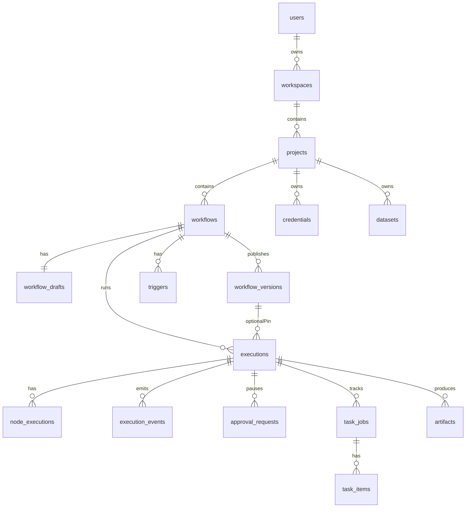
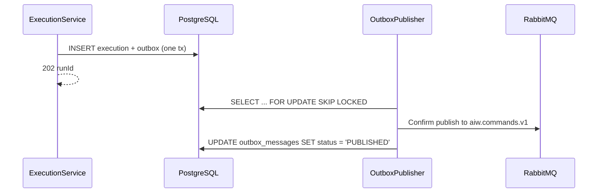

# Control Plane — Low-Level Design (LLD)

Implementable blueprint for `services/control-plane`. Field names follow HTTP camelCase at the API edge and snake_case in stored definitions / broker payloads. When this prose and `contracts/` disagree, **contracts win**.

---

## 1. Technical Baseline

| Concern | Choice |
| --- | --- |
| Language | Java 21 |
| Framework | Spring Boot (MVC, Security, Data JPA) |
| Migrations | Flyway (forward-only, `public.*` schema) |
| Scheduling | Quartz JDBC **clustered** (`org.quartz.jobStore.isClustered=true`) |
| Messaging | Spring AMQP (RabbitMQ) |
| Object Storage | S3-compatible client (MinIO; swap to managed AWS S3 via configuration) |
| Testing | Maven Wrapper; JUnit 5, Mockito, AssertJ, Testcontainers |

---

## 2. Vertical Slice Pattern

```text
<feature>/
|-- api/          # REST controllers + Request/Response DTOs (Java records)
|-- application/  # Use cases, application services + @Transactional boundaries
|-- domain/       # JPA Entities, value objects, domain policies, DomainException
`-- persistence/  # Spring Data JPA Repositories + mappers
```

Cross-cutting modules:
- `common.problem`: RFC 7807/9457 `ProblemDetail` responses
- `common.ids`: Strongly-typed UUID parsing and validation
- `common.time`: Injected `Clock` bean for deterministic test time
- `common.pagination`: Cursor-based pagination (`limit`, `cursor`, `hasMore`, `nextCursor`)
- `security`: SecurityFilterChain, JWT authentication, user principals, project-level RBAC
- `messaging`: Outbox publisher, event consumer, message envelope validation, inbox deduplication

---

## 3. Application Services

| Service | Responsibility |
| --- | --- |
| `AuthService` | User registration, login, refresh token rotation/revocation, Argon2id password hashing. |
| `ProjectService` | Project CRUD and workspace membership enforcement. |
| `WorkflowDraftService` | Draft CRUD, optimistic revision locking (`revision = revision + 1`). |
| `WorkflowValidationService` | 12-stage validation pipeline (schema, manifest, graph, conditions, ports, input bindings). |
| `WorkflowPublicationService` | Atomic immutable version creation with canonical SHA-256 `definition_hash`. |
| `NodeCatalogService` | Load and serve node manifests from `contracts/nodes/catalog/`. |
| `CredentialService` | AES-256 GCM encryption/decryption, masking, internal resolve against run snapshots. |
| `DatasetService` | Dataset/document metadata, signed S3 upload intents for clients. |
| `TriggerService` | Webhook, scheduled (Quartz), and manual trigger rows pinned to published versions. |
| `ExecutionService` | Create, query, and cancel workflow executions; transactional outbox command publishing. |
| `ApprovalService` | Authorize human decisions on approval interrupts and publish `execution.resume`. |
| `TaskJobService` | Read model for durable tasks, cursor-paged item outcomes, cancellation. |
| `ArtifactService` | Authorize short-lived signed artifact download URLs. |
| `AuditService` | Record immutable audit rows for auth, publish, credential, and trigger actions. |
| `ExecutionEventProjector` | Idempotently project worker events into `executions` and `node_executions` read models. |
| `OutboxPublisher` | `FOR UPDATE SKIP LOCKED` poller, broker publisher with RabbitMQ publisher confirms. |

---

## 4. REST Endpoints Specification

All public endpoints are rooted under `/api/v1` (with Webhooks under `/hooks/v1` and Internal endpoints under `/internal/v1`).

### 4.1 Authentication Endpoints (`/api/v1/auth`)

| Method | Path | Behavior |
| --- | --- | --- |
| `POST` | `/api/v1/auth/register` | Register user and initialize personal workspace; return access token and set HTTP-only refresh cookie. |
| `POST` | `/api/v1/auth/login` | Authenticate; return short-lived access token (~10m) and set HTTP-only refresh cookie. |
| `POST` | `/api/v1/auth/refresh` | Rotate refresh token family; return new access token. |
| `POST` | `/api/v1/auth/logout` | Revoke active refresh token and clear cookie. |
| `GET` | `/api/v1/auth/me` | Return authenticated user identity, workspace, and roles. |

### 4.2 Projects & Workflows Endpoints

| Method | Path | Behavior |
| --- | --- | --- |
| `GET` | `/api/v1/projects` | List authorized projects with cursor pagination. |
| `POST` | `/api/v1/projects` | Create a new project within current workspace. |
| `GET` | `/api/v1/projects/{projectId}` | Get project details. |
| `PATCH` | `/api/v1/projects/{projectId}` | Update project name/description. |
| `GET` | `/api/v1/projects/{projectId}/workflows` | List workflows in project. |
| `POST` | `/api/v1/projects/{projectId}/workflows` | Create workflow and initialize empty draft. |
| `GET` | `/api/v1/projects/{projectId}/workflows/{workflowId}` | Get workflow summary and latest version metadata. |
| `GET` | `/api/v1/projects/{projectId}/workflows/{workflowId}/draft` | Get active mutable draft and its `revision`. |
| `PUT` | `/api/v1/projects/{projectId}/workflows/{workflowId}/draft` | Optimistically replace draft (checks `revision`). |
| `POST` | `/api/v1/projects/{projectId}/workflows/{workflowId}/validate` | Run authoritative 12-stage validation on draft. |
| `POST` | `/api/v1/projects/{projectId}/workflows/{workflowId}/publish` | Atomically validate and freeze draft into immutable version. |
| `GET` | `/api/v1/projects/{projectId}/workflows/{workflowId}/versions` | List published immutable versions. |
| `GET` | `/api/v1/projects/{projectId}/workflows/{workflowId}/versions/{v}` | Get published version definition. |
| `GET` | `/api/v1/node-catalog` | Return supported node manifests from catalog. |

### 4.3 Credentials & Datasets Endpoints

| Method | Path | Behavior |
| --- | --- | --- |
| `GET` | `/api/v1/projects/{projectId}/credentials` | List masked credential metadata (never secrets). |
| `POST` | `/api/v1/projects/{projectId}/credentials` | Encrypt secret via AES-256 GCM and save credential row. |
| `PUT` | `/api/v1/projects/{projectId}/credentials/{credId}` | Update credential secret/metadata. |
| `DELETE` | `/api/v1/projects/{projectId}/credentials/{credId}` | Delete credential if unreferenced. |
| `GET` | `/api/v1/projects/{projectId}/datasets` | List datasets. |
| `POST` | `/api/v1/projects/{projectId}/datasets` | Create dataset. |
| `POST` | `/api/v1/projects/{projectId}/datasets/{dsId}/documents/uploads` | Generate signed MinIO upload intent for client. |
| `POST` | `/api/v1/projects/{projectId}/datasets/{dsId}/documents` | Confirm upload and dispatch `document.ingest` outbox command. |
| `GET` | `/api/v1/projects/{projectId}/datasets/{dsId}/documents` | List documents and indexing statuses. |
| `DELETE` | `/api/v1/projects/{projectId}/datasets/{dsId}/documents/{docId}`| Mark deleting and dispatch `document.delete` outbox command. |

### 4.4 Executions, Approvals & Tasks Endpoints

| Method | Path | Behavior |
| --- | --- | --- |
| `POST` | `/api/v1/projects/{projectId}/workflows/{wId}/executions` | Start execution (`mode=draft` or `mode=published`). |
| `GET` | `/api/v1/projects/{projectId}/executions` | List executions with filters and cursor pagination. |
| `GET` | `/api/v1/projects/{projectId}/executions/{runId}` | Get execution read model, node timings, and outputs. |
| `POST` | `/api/v1/projects/{projectId}/executions/{runId}/cancel` | Request cooperative cancellation (`execution.cancel`). |
| `GET` | `/api/v1/projects/{projectId}/executions/{runId}/events` | Server-Sent Events (SSE) live stream with replay. |
| `GET` | `/api/v1/projects/{projectId}/executions/{runId}/tasks` | List durable heavy tasks for a run. |
| `GET` | `/api/v1/projects/{projectId}/tasks/{taskId}` | Get durable task progress and item counts. |
| `GET` | `/api/v1/projects/{projectId}/tasks/{taskId}/items` | Cursor-page item-level outcomes. |
| `POST` | `/api/v1/projects/{projectId}/tasks/{taskId}/cancel` | Cancel heavy task and parent workflow run. |
| `GET` | `/api/v1/projects/{projectId}/artifacts/{artId}/download` | Return short-lived signed S3 download URL. |
| `GET` | `/api/v1/approvals` | List pending approval requests for current user. |
| `POST` | `/api/v1/projects/{projectId}/executions/{runId}/approvals/{appId}/decision` | Submit human decision (`APPROVED`/`REJECTED`) and queue resume. |
| `GET` | `/api/v1/projects/{projectId}/workflows/{wId}/triggers` | List triggers. |
| `POST` | `/api/v1/projects/{projectId}/workflows/{wId}/triggers` | Create trigger pinned to a published version. |
| `PATCH` | `/api/v1/projects/{projectId}/workflows/{wId}/triggers/{tId}` | Activate, deactivate, or repin trigger. |
| `DELETE` | `/api/v1/projects/{projectId}/workflows/{wId}/triggers/{tId}` | Delete trigger. |

### 4.5 Webhook & Internal Endpoints

| Method | Path | Behavior |
| --- | --- | --- |
| `POST` | `/hooks/v1/{publicId}/{secret}` | Public webhook receiver; validates trigger secret and triggers pinned run. |
| `POST` | `/internal/v1/executions/{runId}/credentials:resolve` | Worker credential resolver: validates run snapshot declares slot, then decrypts. |
| `POST` | `/internal/v1/documents/{documentId}/download-intent` | RAG worker download intent: generates short-lived MinIO read intent. |
| `GET` | `/actuator/health/liveness` | Spring Boot liveness probe. |
| `GET` | `/actuator/health/readiness` | Checks DB and RabbitMQ connectivity. |

---

## 5. Domain Model (Entity Schema)



### Key Database Tables (`public.*` Schema):
- `users`: User identity, password hash (`argon2id`).
- `workspaces` & `projects`: Tenant isolation.
- `workflows`: Top-level workflow record.
- `workflow_drafts`: Mutable draft definition (`revision` integer for optimistic locking).
- `workflow_versions`: Immutable published versions (`version` integer, `definition_hash` SHA-256).
- `credentials`: Encrypted secrets (AES-256 GCM, `encrypted_blob`, `nonce`, `key_id`).
- `executions`: Run records (`status = QUEUED|RUNNING|WAITING|SUCCEEDED|FAILED|CANCELLING|CANCELLED|TIMED_OUT`).
- `node_executions`: Step-level inputs, outputs, error details, duration.
- `execution_events`: Monotonic event log (`sequence` per run) backing SSE replay.
- `approval_requests`: Human interrupts awaiting user action.
- `outbox_messages`: Transactional outbox table (`status = PENDING|PUBLISHED|FAILED`).
- `consumed_messages`: Inbox idempotency table for projector consumers.

---

## 6. Outbox Pattern & Event Projection



1. **Transactional Command Guarantee:** Creating an execution and inserting its outbox message occurs in a single local ACID transaction.
2. **SKIP LOCKED Polling:** `OutboxPublisher` polls using `SELECT * FROM outbox_messages WHERE status = 'PENDING' FOR UPDATE SKIP LOCKED`. Multiple Spring instances scale without lock contention.
3. **Event Projection:** Events arriving on `aiw.control.events.v1` are projected into `executions` and `node_executions` within a transaction that also records `(execution_id, sequence)` into `consumed_messages`.
