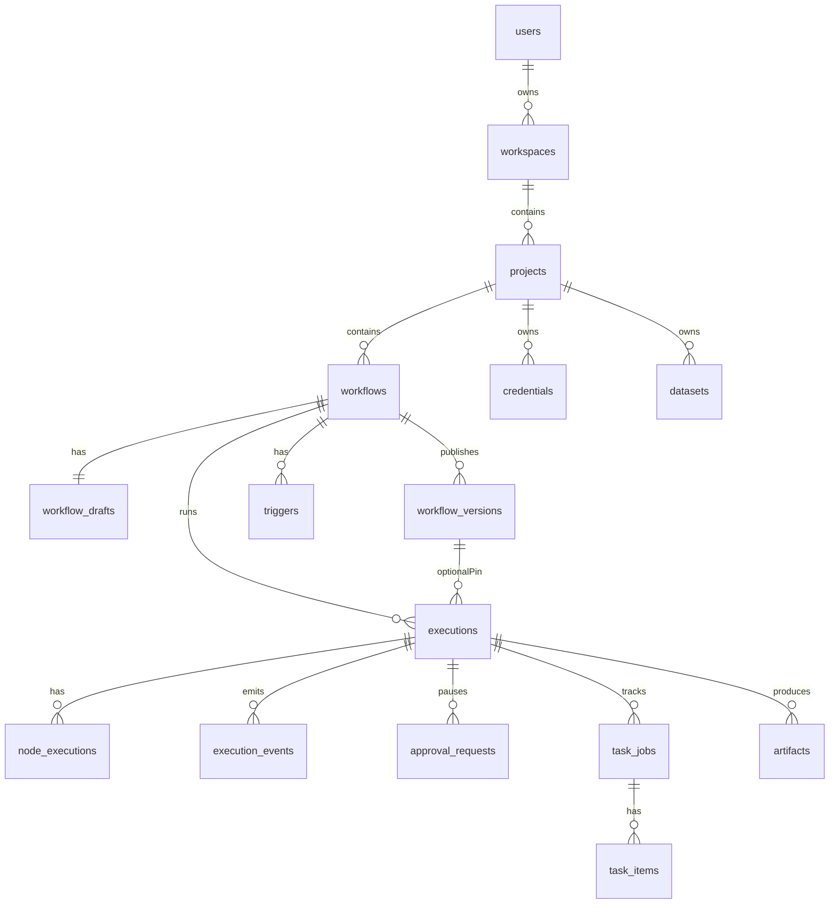
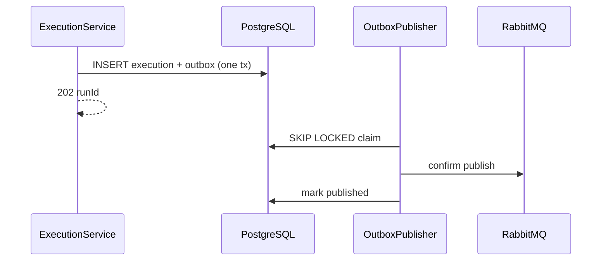
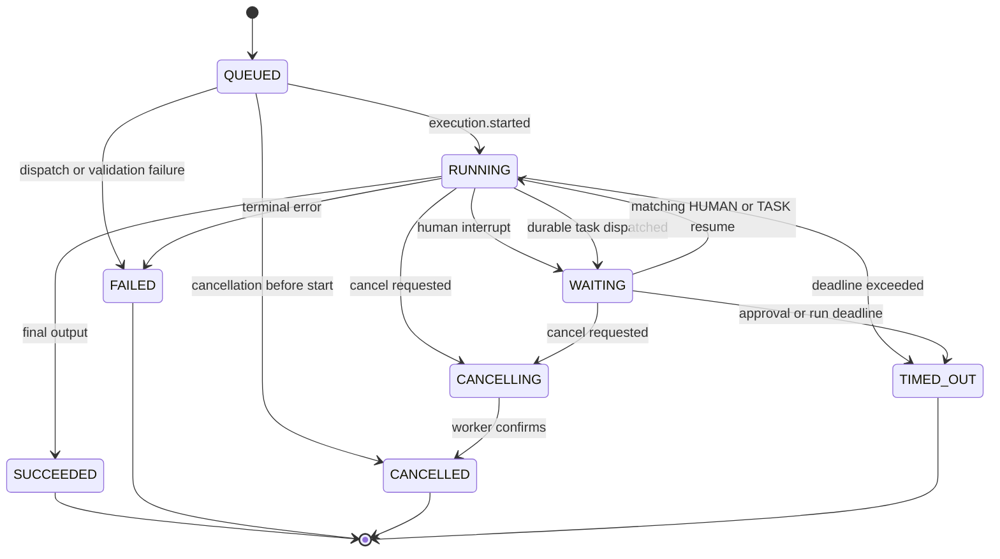
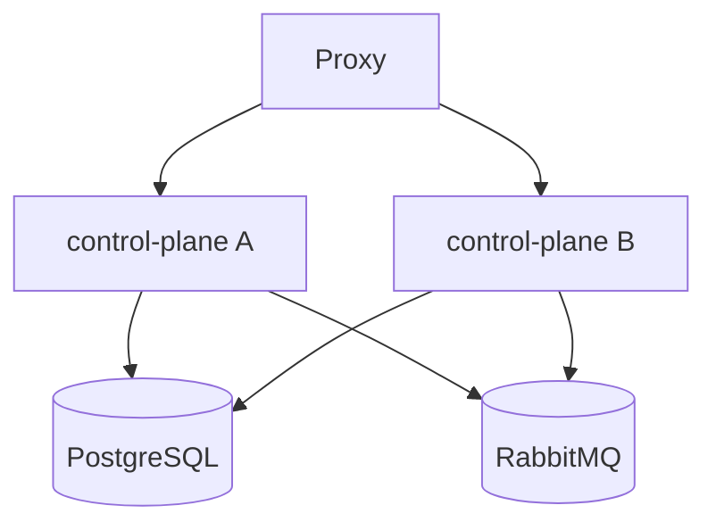
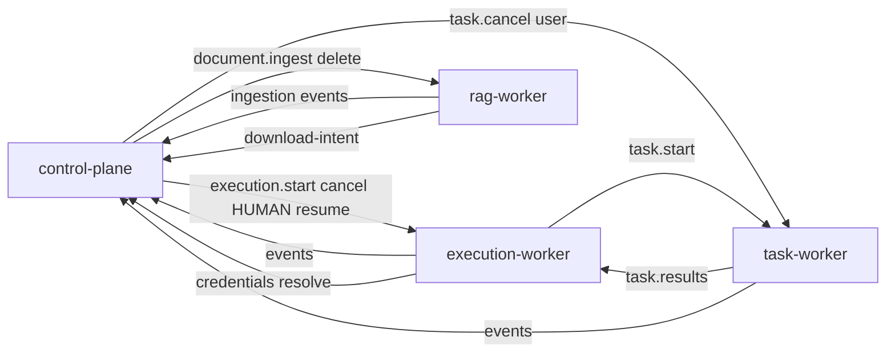

# Control Plane — Low-Level Design

Implementable blueprint for `services/control-plane`. Field names follow HTTP camelCase at the API edge and snake_case in stored definitions / broker payloads. When this prose and `contracts/` disagree, **contracts win**.

Full public/internal HTTP tables: [../LLD.md](../LLD.md) §6.3–6.4.

## 1. Technical baseline

| Concern | Choice |
| --- | --- |
| Language | Java 21 |
| Framework | Spring Boot (MVC, Security, Data JPA) |
| Migrations | Flyway (forward-only) |
| Scheduling | Quartz JDBC **clustered** |
| Messaging | Spring AMQP |
| Objects | S3-compatible client (MinIO; swap to managed S3 via config) |
| Build / test | Maven Wrapper; JUnit 5, Mockito, AssertJ, Testcontainers |

## 2. Vertical slice pattern

```text
<feature>/
|-- api/          # controllers + DTOs
|-- application/  # use cases + @Transactional
|-- domain/       # entities, policies, domain errors
`-- persistence/  # JPA + repositories + mappers
```

Cross-cutting: `common.problem`, `common.ids`, `common.time`, `common.pagination`, `security`, `messaging`.

`NodeCatalogService` lives under `catalog/` (manifests from `contracts/nodes/catalog`). Do not `switch` on node type for execution.

## 3. Application services

| Service | Responsibility |
| --- | --- |
| `AuthService` | Register, login, refresh rotate/revoke, Argon2id. Interface so OIDC can be added later without changing project/workflow APIs. |
| `ProjectService` | Project CRUD + membership checks (MVP: owner/member only; `workspace_memberships.role` reserved) |
| `WorkflowDraftService` | Draft CRUD + optimistic revision |
| `WorkflowValidationService` | Ordered validation stages (schema + graph + refs); new rules are extra stages |
| `WorkflowPublicationService` | Atomic immutable versions |
| `NodeCatalogService` | Load manifests from `contracts/nodes/catalog` |
| `CredentialService` | AES-GCM encrypt, mask, internal resolve against the **run snapshot** |
| `DatasetService` | Dataset/document metadata + signed **upload** intents |
| `TriggerService` | Webhook / schedule / production-manual rows pinned to a published version |
| `ExecutionService` | Create/cancel/query runs + outbox (`mode=draft\|published`) |
| `ApprovalService` | Authorize HUMAN decision + `execution.resume` outbox |
| `TaskJobService` | Task read model, item pages, user cancel (`task.cancel` + parent `execution.cancel`) |
| `ArtifactService` | Authorize **download** only (workers write objects) |
| `AuditService` | Auth/publish/credential/trigger/run/approval audit rows |
| `ExecutionEventProjector` | Idempotent event → read model; unknown types quarantine |
| `OutboxPublisher` | SKIP LOCKED claim, confirm, mark published |

## 4. Controllers (summary)

| Controller | Base |
| --- | --- |
| Auth | `/api/v1/auth` |
| Project | `/api/v1/projects` |
| Workflow | `/api/v1/projects/{projectId}/workflows` |
| NodeCatalog | `/api/v1/node-catalog` |
| Credential | `/api/v1/projects/{projectId}/credentials` |
| Dataset | `/api/v1/projects/{projectId}/datasets` |
| Trigger | `/api/v1/projects/{projectId}/workflows/{workflowId}/triggers` |
| Execution | `/api/v1/projects/{projectId}/executions` (+ start under workflow) |
| Approval | `/api/v1/approvals` + run-scoped decision |
| Task | `/api/v1/projects/{projectId}/tasks` |
| Artifact | `/api/v1/projects/{projectId}/artifacts` |
| Webhook | `/hooks/v1/{publicId}/{secret}` |
| Internal | `/internal/v1/executions/...`, `/internal/v1/documents/...` (not on the public proxy) |
| Health | `/actuator/health/liveness\|readiness` |

Lists use **cursor** pagination, not offset.

## 5. Domain model (ER sketch)



Platform tables also include `outbox_messages`, `consumed_messages`, `audit_events`, Quartz JDBC tables. Full column map: [../04-data-ownership.md](../04-data-ownership.md).

`executions.mode` is `draft` or `published`. `workflow_version_id` is required for published runs and **null** for draft test runs. Triggers always pin a published `workflow_version_id`.

Enforce a unique accepted-run `idempotency_key` (scoped to workspace/project) so webhook/API retries do not insert two executions.

### Draft concurrency

```sql
UPDATE workflow_drafts
SET revision = revision + 1, definition_json = ?, updated_by = ?, updated_at = ?
WHERE workflow_id = ? AND revision = ?;
```

Zero rows → `409 Conflict` (client keeps local edits).

### Publication

One transaction: lock workflow row → full validate → bump `latest_version` → insert `workflow_versions` with `definition_hash` (canonical JSON bytes of the frozen definition). Never rewrite `definition_json` in place.

## 6. Validation pipeline

Ordered stages (plug in a new rule as a new stage; do not fork the service):

1. Parse + byte limit
2. JSON Schema
3. Unique node/edge IDs
4. Resolve manifests / major versions
5. Config + credential/resource slots
6. Ports (direction, cardinality, schema)
7. Input bindings (required ports bound, reachable sources, path/type compatibility) or pass-through inference from edges — see [../05-workflow-wiring.md](../05-workflow-wiring.md)
8. Exactly one Input/start node + reachability + Output reachable (platform webhook/schedule are **not** graph trigger nodes)
9. Condition AST
10. Tarjan SCC → cycles only via `control.loop@1`
11. Graph/loop/policy limits (`min(definition.execution_policy, AIW_MAX_*)`; policy may only tighten)
12. Credential/dataset ownership (publish)

Return **all** practical errors with stable codes and node/edge paths. Java and Python both run the shared `contracts/fixtures` harness.

## 7. Execution + outbox



On insert, status is `QUEUED`. Commands have `sequence: null`. Envelope `causation_id` is set when a parent `message_id` exists; `execution.start` may use null.

### Legal run states

`QUEUED`, `RUNNING`, `WAITING` (`waiting_reason = HUMAN | TASK`), `SUCCEEDED`, `FAILED`, `CANCELLING`, `CANCELLED`, `TIMED_OUT`.



Terminal states never return to active. Duplicate events are no-ops. Illegal transitions → quarantine, do not force. Timeout may arrive as `execution.failed` with code/status `TIMED_OUT`.

### Event projection

- Dedup via `consumed_messages` + unique `(execution_id, sequence)`.
- First broker lifecycle event may be `execution.started` (`sequence` starting at 1). Do not wait for `execution.queued`.
- `execution.waiting` + `HUMAN` → `approval_requests`. `TASK` → no approval row and **no** CP `execution.resume`.
- Terminal success type is `execution.completed` (never `execution.succeeded`).
- Unknown `message_type` → quarantine/DLQ; do not crash the consumer.
- Notify SSE after commit (live notify may be local to this instance; replay is from DB).
- Never write `ee.*` or `rag.*` schemas.

### SSE

- Authorize run, replay after `Last-Event-ID` (`id = sequence`).
- Heartbeats; close on terminal.
- Bound connections per user/workspace.
- No blobs; large results are artifact refs.

### Cancel

- User cancel run → outbox `execution.cancel`. Walker owns `ee.run_cancels` and child-task cancel.
- User cancel task → outbox `task.cancel` **and** parent `execution.cancel`.
- Late node results must not move a terminal run back to `RUNNING`.

## 8. Auth and credentials

| Topic | Design |
| --- | --- |
| Password | Argon2id |
| Access JWT | Short-lived (~10m), in-memory on client; process is otherwise stateless |
| Refresh | HTTP-only cookie; hashed in DB; rotate; reuse revokes family |
| Credential at rest | AES-GCM, unique nonce, `key_id`, AAD = id+workspace+project+type |
| Key rotation | Decrypt with row `key_id`; re-encrypt on update |
| Internal resolve | Service JWT (mTLS later). Body camelCase: `nodeId`, `slots`, `workflowVersionId` **nullable** for draft runs. Verify the **run’s frozen definition** declares the slots, then decrypt. Never decrypt unless the snapshot declares the slot. |
| Errors | RFC 9457 problem body; never leak secrets/SQL/stacks |

## 9. Triggers

| Type | Behavior |
| --- | --- |
| Manual (production) | API start of a **published** version with validated input (optional trigger row) |
| Draft test | `ExecutionService` `mode=draft` — **not** a trigger row; no version pin |
| Webhook | `/hooks/v1/{publicId}/{secret}`; hashed secret; opaque 401/404 |
| Schedule | Quartz JDBC clustered; app `triggers` row is authority for pin/active |

Webhook/schedule/production-manual **always** pin a published `workflow_version_id`. Schedule dispatch is one idempotent `execution.start`.

## 10. Approvals

1. Projector persists `approval_requests` from `execution.waiting` with `waiting_reason=HUMAN` only.
2. Reviewer posts decision → authorize → resolve atomically.
3. Outbox `execution.resume` with `waiting_reason=HUMAN`, `interrupt_id`, `approval_id`; `task_id` null.
4. Reject if run is not waiting HUMAN or already resolved (`409`).
5. Never publish `execution.resume` for `TASK` waits (execution-worker resumes from `aiw.task.results.v1`).

## 11. Error model

```json
{
  "type": "https://errors.example.dev/workflow-validation",
  "title": "Workflow validation failed",
  "status": 422,
  "code": "WORKFLOW_INVALID",
  "correlationId": "uuid",
  "errors": [
    {
      "code": "PORT_INCOMPATIBLE",
      "path": "/edges/2",
      "edgeId": "uuid",
      "message": "Output 'text' is not compatible with input 'documents'"
    },
    {
      "code": "BINDING_MISSING",
      "path": "/nodes/1/input_bindings",
      "nodeId": "uuid",
      "message": "Required input port 'prompt' has no binding"
    }
  ]
}
```

## 12. Configuration (representative)

`AIW_DATABASE_URL`, `AIW_RABBITMQ_URL`, `AIW_MINIO_*`, `AIW_JWT_*`, `AIW_CREDENTIAL_MASTER_KEY`, `AIW_CREDENTIAL_KEY_ID`, `AIW_INTERNAL_AUTH_*`, `AIW_PUBLIC_BASE_URL`, graph/run limit vars (`AIW_MAX_*` — **same names and values as workers** in Compose). Fail fast on missing env **names**; never log values.

Per-workspace concurrency and rate limits apply at **run accept** time (`429`/`422`). Do not queue unbounded work in Spring.

## 13. Test boundaries

| Layer | Focus |
| --- | --- |
| Unit | Auth rotation, validation stages, state machine, crypto, projector idempotency |
| Integration | Flyway, outbox, RabbitMQ redelivery, clustered Quartz, MinIO intents |
| Contract | Shared fixtures accept/reject identically to Python |

## 14. Implementation order

See [BUILD-GUIDE.md](./BUILD-GUIDE.md). Align with plan phases **2–8** for control-plane (Java) scope; skip React- and Python-only items.

## 15. Scale-out and evolution

HLD §12: Spring scales horizontally; PostgreSQL is the ceiling. No Redis, Kubernetes autoscaling, or multi-region in MVP. Keep the process stateless so those are not blocked later.



- **Stateless process.** Access JWT is self-contained; refresh tokens and product state live in Postgres. REST needs no sticky sessions.
- **Outbox.** `FOR UPDATE SKIP LOCKED`; one row claimed by one publisher. Metric: outbox age/backlog.
- **Inbox / projector.** Competing consumers on `aiw.control.events.v1`; bounded prefetch.
- **Quartz.** JDBC job store with `org.quartz.jobStore.isClustered=true` so two instances do not double-fire.
- **SSE.** Source of truth is `execution_events`. Live notify may be instance-local. Any instance serves replay via `Last-Event-ID`. Optional fan-out bus is later, not MVP.
- **HTTP API.** Stay on `/api/v1`. Additive camelCase fields; unknown fields rejected per contract major. Stable problem `code`s. Breaking changes → `/api/v2` (do not design v2 now).
- **New nodes.** Catalog + JSON Schema only.
- **New trigger types.** `TriggerService` strategy + outbox `execution.start`, not a new run table.
- **Internal auth.** Service JWT now; mTLS/workload identity later without changing resolve URLs.
- **Retention.** Configurable purge for events, `consumed_messages`, expired refresh tokens.
- **Non-goals (do not promise):** K8s autoscaling, multi-region, collaborative editing, billing.

## 16. Join contract (workers)

Command ownership (must not double-fire):

| Message | Publisher | Consumer | Control plane must not |
| --- | --- | --- | --- |
| `execution.start` | CP outbox | execution-worker | — |
| `execution.cancel` | CP outbox | execution-worker | — |
| `execution.resume` | CP outbox **only if** `waiting_reason=HUMAN` | execution-worker | Resume `TASK` |
| `document.ingest` / `document.delete` | CP outbox | **rag-worker** | Route to execution-worker |
| `task.start` | **execution-worker** | task-worker | Publish `task.start` |
| `task.cancel` | CP (user) and/or execution-worker (run cancel) | task-worker | Resume the parent walker |



`execution.start` payload (see `contracts/messages/commands/execution.start.schema.json`):

- Embed the frozen `definition`. Broker snake_case.
- `mode=published` → `definition.workflow_version_id` UUID; `draft_revision` null.
- `mode=draft` → `workflow_version_id` null; `draft_revision` required.
- Envelope `tenant.workspace_id` + `project_id` required. Never substitute `workflow_id`.
- `subject.run_id` = `executions.id` = walker `thread_id`.
- No credential plaintext.
- Same `definition_hash` as publish. Resume loads `ee.workflow_definitions` by hash, not a second start payload.

Dual validation: worker revalidation failure → `execution.failed`; do not skip because Java already validated.

Download-intent is for **rag-worker** source-document reads. Execution- and task-workers call credential resolve. Artifact **writes** use worker S3 credentials; Spring only signs downloads.

Failure ownership: publish/authz `422`/`403`/`404` from Spring; broker after commit = outbox retry; runtime = worker events; duplicates = inbox; DLQ = new run (no silent replay into a changed draft).
