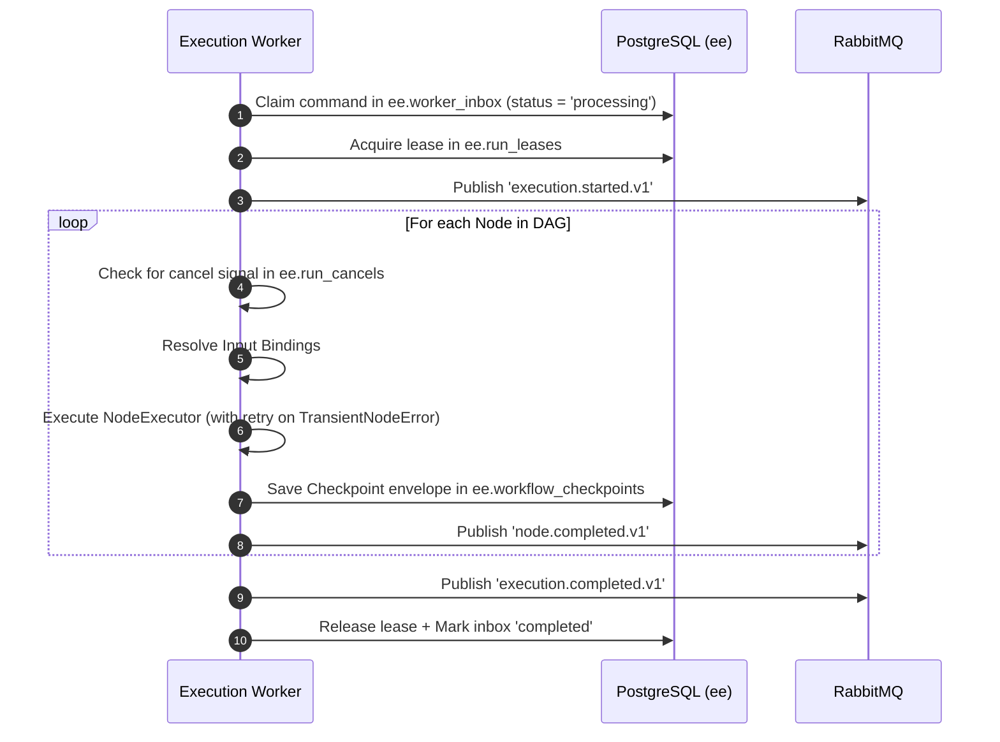

# Execution Engine — Low-Level Design (LLD)

Target blueprint for `services/execution-engine`. When prose and `contracts/` disagree, **contracts win**.

This document is **as-built plus locked Target**. Cross-service architecture and messaging topology are defined in [../HLD.md](../HLD.md).

---

## 1. Technical Baseline

| Concern | Choice |
| --- | --- |
| Language | Python 3.12+ |
| API | FastAPI health/readiness only (`/health`, `/ready`) |
| Runtime | Custom **interpreter/walker** + PostgreSQL checkpointer (`ee.workflow_checkpoints`, `thread_id = run_id`). **Not LangGraph.** |
| Models | Pydantic v2 aligned to JSON Schema + shared fixtures (`contracts/`) |
| Messaging | `aio-pika`; durable queues; DLX `aiw.dead.v1` bound on command queues |
| Database | async PostgreSQL (`ee.*` checkpoints, inbox, leases, definitions, action keys). Vector tables are **rag-owned**; EE reads only. |
| Outbound HTTP | `httpx` + hard timeouts + mandatory pre-request SSRF IP guards |
| Objects | S3-compatible (MinIO) for execution artifacts |
| Tooling | `uv`, Ruff, Pyright, `pytest-asyncio`, `respx`, Testcontainers |

---

## 2. Package Layout (As-Built)

```text
src/ai_workflow/
|-- api/           # FastAPI health/readiness probes
|-- config/        # Settings, environment limits, structured logging
|-- contracts/     # Pydantic v2 schema models generated from contracts/
|-- messaging/     # RabbitMQ topology, consumers, publisher, postgres inbox
|-- runtime/       # Custom walker, IR cache, state, bindings, semantic validator, checkpoints, leases, cancels
|-- nodes/         # Node executors by category (action, ai, control, human, rag)
|-- rag/           # In-process vector retrieval against rag schema
|-- security/      # Credential resolver, recursive redaction, SSRF validator
|-- tasks/         # Durable task framework + heavy domain executors
|-- providers/     # OpenAI-compatible chat & embedding clients
`-- worker/        # execution_worker and task_worker process entrypoints
```

> [!IMPORTANT]
> Lower layers (`runtime`, `nodes`, `security`) must not import `worker` or `api` modules.

---

## 3. Locked Architectural Invariants

### 3.1 Interpreter, Not Compiler
The walker interprets a validated definition. `WorkflowIR` is an in-process cache of adjacency, input bindings, caps, and `definition_hash`. It is not an executable compiled graph or dynamic script.

### 3.2 Resume Ownership & Protocol
- A parent run waits with `waiting_reason = HUMAN` or `TASK`.
- **Only `execution.resume` continues the walker.**
- Task-worker never calls `run_workflow`.
- Execution-worker consumes `task.completed` / `task.failed` from `aiw.task.results.v1` and issues the matching `resume_workflow` in-process. Control-plane must **not** send `execution.resume` for TASK interrupts.
- `execution.resume` does not carry the workflow definition; the worker loads it from `ee.workflow_definitions` by canonical SHA-256 hash.

### 3.3 Per-Run Distributed Lease & Inbox
- One worker owns a `run_id` at a time via `ee.run_leases` mutex.
- Inbox reclaim TTL is **greater than** `AIW_MAX_RUN_SECONDS` (360s vs 300s). A live run is never reclaimed prematurely.
- In-flight command handlers are bounded by a concurrency semaphore matching QoS prefetch.

### 3.4 Cooperative Cancellation
Cancel requests are persisted in `ee.run_cancels`. The walker and node executors poll `ee.run_cancels` across process boundaries during execution and between loop/for-each iterations.

### 3.5 Artifact Handling
Workers write large outputs and report artifacts directly to MinIO. Node outputs retain a lightweight `summary` + `artifact_ref` metadata object.

### 3.6 Side-Effect Idempotency Keys
Outbound HTTP side-effects use stable execution keys: `run_id:node_id` (plus `item_key` inside for-each). **Retry `attempt` is deliberately NOT part of the key.**

### 3.7 Semantic Validation Guardrails
Forbidden inside a `control.for-each@1` body:
- `human.approval@1`, `human.review@1`
- `control.for-each@1`, `control.loop@1`
- Any `execution_mode=durable-task` node

---

## 4. Core Protocols

```python
class NodeExecutor(Protocol):
    node_type: str

    async def execute(
        self, context: ExecutionContext, config: dict, inputs: dict
    ) -> NodeResult: ...


class DurableTaskExecutor(Protocol):
    task_type: str

    async def run(
        self,
        context: TaskContext,
        payload: dict,
        checkpoint: TaskCheckpoint | None,
    ) -> TaskResult: ...


class ControlFlowHandler(Protocol):
    node_type: str

    async def after_node(
        self, *, node, result, state, scheduler, workflow, registry, run_id
    ) -> None: ...
```

---

## 5. Runtime Registry

The `RuntimeRegistry` maps `type@majorVersion` &rarr; manifest, `default_bindings`, executor factory, and optional `ControlFlowHandler`.

Startup strictly fails if:
- Duplicate node type registration is detected.
- An execution-engine owned catalog node is missing an executor.
- An executor is missing a valid JSON Schema catalog manifest.

---

## 6. Execution Path & Checkpointing



### Checkpoint Envelope Schema (`schema_version = 1`):
```json
{
  "schema_version": 1,
  "definition_hash": "sha256-hex",
  "scheduler": {
    "ready": ["node-uuid-3"],
    "completed": ["node-uuid-1", "node-uuid-2"],
    "running": []
  },
  "interrupt": null,
  "foreach": null,
  "node_outputs": {
    "node-uuid-1": { "text": { "text": "Hello world" } }
  },
  "loop_iterations": {
    "loop-node-uuid": 2
  },
  "task_refs": {},
  "runtime": {
    "run_input": {},
    "workspace_id": "uuid",
    "project_id": "uuid"
  }
}
```

---

## 7. Storage & Schema Ownership (`ee.*`)

| Table / Object | Purpose & Invariants |
|---|---|
| `ee.workflow_checkpoints` | Versioned walker state saved after every node boundary. |
| `ee.workflow_definitions` | Content-addressed storage for immutable workflow definitions (keyed by SHA-256). |
| `ee.run_leases` | Exclusive distributed run ownership mutex (`heartbeat_at`, `expires_at`). |
| `ee.worker_inbox` | Command idempotency table (`status = 'processing'\|'completed'\|'failed'`). |
| `ee.run_cancels` | Durable cancel requests polled by walker and node executors. |
| `ee.action_execution_keys` | Outbound HTTP action idempotency keys (`run_id:node_id`). |
| `rag.*` | Document vector embeddings (**read-only** access from execution engine). |
| MinIO `artifacts/` | Uploaded output artifacts, reports, and bulk datasets. |
