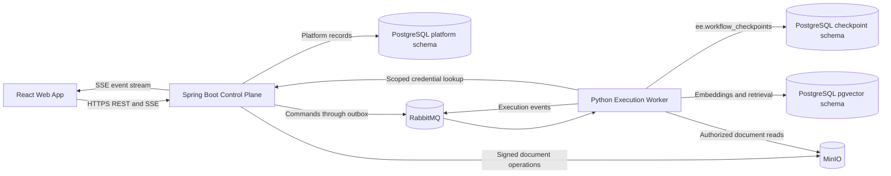

# AI Workflow Platform: Detailed Implementation Plan

## 1. Product Goal

Build a visual AI workflow platform in which authenticated users can create, validate, publish, trigger, monitor, pause, and resume complex workflows.

The platform will use:

- **React and TypeScript** for the browser application and visual workflow editor.
- **Java and Spring Boot** for the public API and control plane.
- **Python and FastAPI** for AI workflow compilation and execution (durable walker).
- **PostgreSQL with pgvector** for platform records, checkpoints, and vector data.
- **RabbitMQ** for reliable asynchronous commands and execution events.
- **MinIO** for uploaded document storage.
- **Docker Compose** for the first deployable environment.

The MVP must support conditional edges, controlled loops, immutable published workflow versions, execution history, provider credentials, manual/webhook/scheduled triggers, RAG, and human approval. Its node architecture must allow new trigger, action, RAG, and AI nodes to be added later without redesigning the editor or runtime.

## 2. Scope

### 2.1 MVP Capabilities

- Built-in account registration and login.
- Personal workspaces and project isolation.
- Visual node-and-edge workflow editing.
- Draft save, validation, publication, and version history.
- Manual test runs against drafts.
- Manual, webhook, and scheduled runs against published versions.
- Conditional routing with a structured condition builder.
- Fan-out and fan-in execution.
- Explicit, bounded loops.
- OpenAI-compatible chat and embedding providers.
- Document upload, ingestion, vector indexing, and retrieval.
- Human approval and review interrupts.
- Hardened outbound HTTP actions.
- Live run status, node-level inputs and outputs, logs, errors, and timing.
- Run cancellation, retry policy, timeout policy, and restart recovery.
- Extensible node manifests and executor registries.
- Bounded `For Each` processing for lists with configurable concurrency and failure policy.
- Durable heavy-task jobs with progress, checkpoints, cancellation, budgets, and downloadable artifacts.
- Explainable stock-list momentum screening through licensed/configured market-data providers.
- Long-running research tasks that preserve sources, citations, evidence, and report artifacts.
- Cleanup tasks with dry-run plans, explicit scope, approval gates, idempotency, and audit history.

### 2.2 Deferred Capabilities

- Enterprise OIDC and SAML.
- Multi-workspace organizations and advanced team roles.
- Billing and usage charging.
- Real-time collaborative graph editing.
- Public node marketplace.
- Arbitrary user-supplied JavaScript or Python execution.
- Dynamically loading untrusted plug-ins.
- Automated brokerage order placement or portfolio management.
- Unrestricted host filesystem, shell, database, or cloud-account cleanup.
- Kubernetes deployment.
- Multi-region execution.

## 3. Architecture



### 3.1 React Web Application

Responsibilities:

- Authentication screens and session renewal.
- Project, workflow, credential, dataset, trigger, run, and approval views.
- React Flow workflow canvas.
- Node palette and configuration inspector.
- Structured condition and loop configuration.
- Client-side graph feedback before server validation.
- Draft save, publish, and test-run commands.
- Live run updates over Server-Sent Events.
- Node-level run inspection and approval forms.

The browser communicates only with Spring Boot. It must never call the Python service directly or receive unmasked credentials.

### 3.2 Spring Boot Control Plane

Responsibilities:

- Public REST API and SSE endpoints.
- Authentication, authorization, and account lifecycle.
- Workspace and project ownership (MVP membership; advanced roles deferred).
- Workflow drafts and immutable published versions.
- Authoritative workflow validation.
- Node catalog aggregation.
- Encrypted credential storage and internal run-scoped resolve.
- Dataset and document metadata; signed upload intents.
- Manual, webhook, and scheduled triggers.
- Run creation (draft test and published) and run-history read models.
- Task/artifact read models and authorized artifact download.
- Transactional outbox command publication (`execution.start`/`cancel`, HUMAN `execution.resume`, ingest/delete, user `task.cancel` — never `task.start`).
- Idempotent consumption of worker events (execution, task, document ingestion).
- Approval authorization and HUMAN resume-command publication.
- Audit records and secret-safe error handling.

### 3.3 Python Execution Plane

Responsibilities:

- Validate received workflow definitions against shared contracts.
- Interpret and run neutral workflow graphs with the durable walker (not a compiled StateGraph).
- Resolve and invoke registered node executors.
- Run AI, RAG **retrieve**, control, approval, and action nodes.
- Persist walker checkpoints in PostgreSQL (`ee.workflow_checkpoints`).
- Emit ordered execution and node status events.
- Enforce retries, timeouts, cancellation, loop limits, and run budgets.
- Redact secrets from outputs, events, and logs.
- Resume interrupted executions after HUMAN `execution.resume` or TASK results (`aiw.task.results.v1`).

Document ingest/delete is owned by `services/rag` (`rag-worker`), not the execution plane.

FastAPI will expose internal health and narrowly scoped service endpoints. RabbitMQ workers will perform long-running execution outside request lifecycles.

## 4. Repository Structure

```text
ai_workflow/
|-- apps/
|   `-- web/
|       |-- src/
|       |   |-- api/
|       |   |-- app/
|       |   |-- components/
|       |   |-- features/
|       |   |   |-- auth/
|       |   |   |-- builder/
|       |   |   |-- credentials/
|       |   |   |-- datasets/
|       |   |   |-- projects/
|       |   |   |-- runs/
|       |   |   `-- workflows/
|       |   `-- test/
|       `-- package.json
|-- services/
|   |-- control-plane/
|   |   |-- src/main/java/
|   |   |-- src/main/resources/db/migration/
|   |   |-- src/test/java/
|   |   `-- pom.xml
|   |-- execution-engine/
|   |   |-- src/ai_workflow/
|   |   |-- tests/
|   |   `-- pyproject.toml
|   `-- rag/
|-- contracts/
|   |-- messages/
|   |-- nodes/
|   `-- workflow/
|-- infra/
|   |-- minio/
|   |-- proxy/
|   `-- rabbitmq/
|-- scripts/
|-- design/
|-- docker-compose.yml
|-- .env.example
`-- README.md
```

## 5. Shared Contracts

JSON Schema will be the canonical cross-language contract format. TypeScript types, Java DTOs, and Pydantic models must be generated from or validated against the same schemas.

### 5.1 Workflow Definition

Each workflow definition contains:

- Contract schema version.
- Workflow ID and workflow-version ID.
- Workflow name and metadata.
- Input and output schemas.
- Node instances.
- Edge instances.
- Execution policy.

Each node instance contains:

- Stable instance UUID.
- Node type in `namespace.name@majorVersion` form.
- Position and editor metadata.
- Node configuration.
- Optional **input bindings** — field-level mappings from upstream outputs to this node's inputs (see [05-workflow-wiring.md](./05-workflow-wiring.md)).
- Credential and collection references by ID, never by secret value.

Each edge contains:

- Stable edge UUID.
- Source node and output port.
- Target node and input port.
- Optional edge label.
- Optional structured condition.

Edges define **graph structure** and execution order. They do not carry field mappings. When `input_bindings` is omitted on a node, the runtime infers whole-port pass-through from incoming edges (`source_port` at `/` → `target_port` at `/`).

Catalog manifests may declare **default bindings** per input port so the editor can auto-wire common cases (e.g. Chat Model `prompt` ← upstream `text`).

### 5.2 Structured Conditions

Conditions must be represented as a safe abstract syntax tree, not executable text. Supported operators should initially include:

- Equality and inequality.
- Numeric and lexical comparison.
- `contains`, `startsWith`, and `endsWith`.
- Null and existence checks.
- Boolean `all`, `any`, and `not` groups.

Operands may reference approved workflow-state paths or JSON literal values. The validator must reject unknown operators, invalid state paths, excessive nesting, and unsafe coercion.

### 5.3 Controlled Loops

Arbitrary graph cycles are invalid. A cycle is permitted only when it returns through an explicit `control.loop@1` node.

Every Loop node requires:

- A `body` output and a `done` output.
- A finite `maxIterations` value.
- A platform-enforced maximum iteration cap.
- An optional structured exit condition.
- A run-level wall-clock budget.

The compiler and server validator must independently reject unbounded loops and cycles that bypass the Loop node.

### 5.4 Node Manifest

Each node type has a versioned manifest defining:

- Type and display name.
- Category: trigger, data, control, AI, RAG, human, or action.
- Execution owner: control plane or execution engine.
- Input and output port schemas.
- Configuration JSON Schema.
- Credential requirements.
- UI hints and icon identifier.
- Retry and timeout capabilities.
- Whether the node performs external side effects.

The React application uses manifests to build the palette, handles, and most configuration forms. Python uses matching registrations to execute runtime-owned nodes. Java uses adapters for control-plane-owned triggers.

### 5.5 Messaging Envelopes

All RabbitMQ messages require:

- Message ID.
- Event or command type.
- Schema version.
- Correlation ID.
- Causation ID.
- Workspace, project, workflow-version, and run IDs.
- Sequence number where ordering matters.
- Idempotency key.
- Creation timestamp.
- JSON payload.

Initial commands:

- `execution.start`
- `execution.cancel`
- `execution.resume`
- `document.ingest`
- `document.delete`

Initial events:

- `execution.queued`
- `execution.started`
- `node.started`
- `node.completed`
- `node.failed`
- `execution.waiting`
- `execution.completed`
- `execution.failed`
- `execution.cancelled`
- `document.ingestion.started`
- `document.ingestion.completed`
- `document.ingestion.failed`

## 6. Core Data Model

### 6.1 Platform Schema

Primary tables:

- `users`
- `workspaces`
- `workspace_memberships`
- `projects`
- `refresh_tokens`
- `workflows`
- `workflow_drafts`
- `workflow_versions`
- `credentials`
- `triggers`
- `datasets`
- `documents`
- `executions`
- `node_executions`
- `execution_events`
- `approval_requests`
- `task_jobs`
- `task_items`
- `artifacts`
- `audit_events`
- `outbox_messages`
- `consumed_messages`

All project resources carry workspace and project ownership. Database indexes must support ownership checks, workflow listing, trigger lookup, event replay, pending approvals, and recent execution history.

### 6.2 Execution States

Legal run states:

- `QUEUED`
- `RUNNING`
- `WAITING`
- `SUCCEEDED`
- `FAILED`
- `CANCELLING`
- `CANCELLED`
- `TIMED_OUT`

State transitions must be explicit and idempotent. Terminal states cannot transition back to active states. `WAITING` carries `waiting_reason = HUMAN | TASK`. Control-plane `execution.resume` is legal only for a HUMAN wait with a matching unresolved approval. TASK waits resume on the execution-worker from `aiw.task.results.v1` (control plane must not also send `execution.resume`).

### 6.3 Storage Ownership

- Spring owns platform tables and Flyway migrations.
- The execution-engine walker owns checkpoint tables (`ee.workflow_checkpoints`) in a separate PostgreSQL schema.
- `services/rag` owns vector/chunk tables (`rag.*`). Execution-engine reads them only.
- MinIO stores source documents under workspace/project-scoped object keys.
- Services must not write directly into another service's owned tables.

## 7. Starter Node Pack

### 7.1 Triggers

- **Manual:** accepts validated run input from the UI or API.
- **Webhook:** verifies an unguessable secret, validates the request, and normalizes the payload.
- **Schedule:** uses a durable Quartz JDBC job and dispatches a normalized start command.

### 7.2 Data and Control

- **Input:** exposes validated workflow inputs.
- **Output:** maps final state into declared workflow outputs.
- **Condition:** evaluates a structured condition and selects a named output path.
- **Merge:** combines explicitly mapped values from incoming branches.
- **Loop:** executes a bounded body path until an exit condition or iteration limit.
- **For Each:** applies a bounded subflow to each collection item with controlled concurrency.
- **Collect:** gathers item results and exposes explicit partial-failure metadata.

### 7.3 AI

- **Prompt Template:** renders named variables into a prompt without evaluating code.
- **Chat Model:** invokes an OpenAI-compatible provider with model, temperature, token, and timeout controls.

### 7.4 RAG

- **Retrieve:** embeds the query and searches one authorized collection using workspace/project filters.

### 7.5 Human

- **Approval:** pauses and accepts approve/reject data.
- **Review:** pauses and permits a reviewer to edit a JSON-serializable value before resuming.

### 7.6 Actions

- **HTTP Request:** invokes approved HTTP/HTTPS destinations with safe headers, timeouts, body-size limits, redirect limits, and SSRF defenses.
- **Market Data:** loads timestamped OHLCV data for an authorized user-supplied watchlist through a configured provider.
- **Momentum Screen:** deterministically scores and ranks stocks using a versioned formula, data-quality flags, and an `asOf` timestamp. It does not place trades or claim personalized financial advice.
- **Deep Research:** runs a durable, budgeted research job and returns a structured report artifact with source URLs, retrieval timestamps, citations, and unsupported-claim warnings.
- **Cleanup Plan:** inventories scoped resources and produces a non-destructive proposed deletion/archive plan.
- **Cleanup Execute:** applies an approved cleanup plan through a typed connector, records per-item outcomes, and supports rollback when the connector permits it. It cannot execute arbitrary shell commands or access undeclared resources.

### 7.7 Heavy-Task Execution

- Heavy nodes run as durable task jobs instead of holding a web request or ordinary node invocation open.
- A parent workflow checkpoints and enters `WAITING` with reason `TASK` while a dedicated worker pool processes the job.
- Jobs expose item counts, progress percentage, current stage, estimated/actual cost, warnings, and artifact references through the run event stream.
- Each job has hard limits for elapsed time, item count, parallelism, retries, provider calls, token use, and artifact bytes.
- Research and cleanup outputs larger than event limits are stored as project-scoped MinIO artifacts; events contain only safe metadata and references.

## 8. Security Design

### 8.1 Authentication

- Hash passwords with Argon2id using current calibrated parameters.
- Issue short-lived signed access JWTs.
- Store rotating refresh tokens in secure, HTTP-only, same-site cookies.
- Store only refresh-token hashes in PostgreSQL.
- Detect refresh-token replay and revoke the affected token family.
- Rate-limit registration, login, refresh, webhook, and credential operations.
- Do not reveal whether an account exists in authentication errors.

### 8.2 Authorization

- Enforce workspace and project authorization in the Spring service layer.
- Never rely only on identifiers supplied by the client.
- Authorize run inspection, cancellation, and approval independently.
- Scope every document and vector operation by workspace, project, and collection.
- Use separate internal service authentication between Java and Python.

### 8.3 Credentials

- Encrypt provider credentials with authenticated encryption and an environment-supplied master key.
- Store key identifiers and support future key rotation.
- Return masked metadata only.
- Resolve credentials through a narrow internal endpoint for a specific authorized run and node.
- Never place provider secrets in workflow JSON, queue messages, logs, or browser responses.

### 8.4 Outbound HTTP Security

- Allow only HTTP and HTTPS methods explicitly supported by the node.
- Resolve DNS and block loopback, link-local, multicast, metadata, and private network destinations by default.
- Revalidate each redirect target.
- Limit redirects, request duration, response bytes, and logged body content.
- Redact secret headers and configured sensitive fields.

### 8.5 Upload Security

- Validate filename, extension, MIME type, and file size.
- Generate storage keys rather than trusting user paths.
- Use signed object operations with short expiration.
- Keep parsing isolated from web request threads.
- Record ingestion failures without leaking extracted sensitive content.

## 9. Frontend Experience

### 9.1 Application Shell

Use a compact, work-focused interface with:

- Left navigation for projects, workflows, runs, datasets, and credentials.
- Top project/workflow context.
- Consistent status colors and restrained neutral surfaces.
- Lucide icons and tooltips for unfamiliar actions.
- Keyboard-accessible menus, dialogs, forms, and canvas controls.

The first screen after login is the workflow/project experience, not a marketing landing page.

### 9.2 Workflow Builder

Builder layout:

- Searchable, categorized node palette on the left.
- React Flow canvas in the center.
- Configuration inspector on the right.
- Save, validate, publish, and run controls at the top.
- Collapsible run inspector at the bottom.

Required editor behavior:

- Drag/drop node creation.
- Typed connection handles (ports from catalog).
- Connection compatibility validation on edges.
- **Input bindings panel** on target nodes: map upstream `source_port` + path → `target_port` + path; show `auto` vs `manual` origin.
- Catalog **default bindings** pre-fill common mappings when an edge is drawn (user override always wins).
- Custom condition edges with concise labels.
- Explicit Loop `body` and `done` outputs.
- Selection, multi-selection, delete, copy, and paste.
- Undo and redo.
- Zoom, fit view, and minimap.
- Unsaved-change protection.
- Stable node dimensions when execution status changes.
- Inline validation markers and a publish-blocking error summary.

Complex graph editing is desktop/tablet oriented. Mobile supports workflow viewing, runs, approvals, and monitoring without forcing the full editor into an unusable viewport.

### 9.3 Run Inspector

- Start a draft test run or a published run with validated input.
- Subscribe to authenticated SSE using replay identifiers.
- Color nodes by queued, running, waiting, succeeded, failed, or cancelled state.
- Show ordered events and per-node inputs/outputs.
- Redact credentials and configured sensitive fields.
- Show duration, retry count, model, token, and estimated cost metadata.
- Support cancellation and approval/review submission.
- Recover cleanly after browser refresh or SSE reconnection.

## 10. Delivery Phases

### Phase 1: Foundation and Contracts

- [ ] Create the monorepo folder structure and root scripts.
- [ ] Scaffold React/Vite, Spring Boot/Maven, and FastAPI/Python projects.
- [ ] Add environment templates and Docker Compose infrastructure.
- [ ] Define workflow, node manifest, condition, loop, command, and event schemas.
- [ ] Add valid and invalid cross-language contract fixtures.
- [ ] Generate or validate language-specific models.
- [ ] Configure linting, formatting, type checking, tests, coverage, and dependency scans.
- [ ] Document local setup and architecture boundaries.

**Exit criteria:** all three projects build, contract fixtures pass in all languages, and invalid arbitrary cycles/unbounded loops are rejected.

### Phase 2: Identity and Workflow Control Plane

- [ ] Implement Flyway platform-schema migrations.
- [ ] Implement registration, login, refresh rotation, logout, and membership checks (advanced team roles deferred).
- [ ] Implement personal workspaces, projects, and ownership checks.
- [ ] Implement workflow draft CRUD.
- [ ] Implement server-side graph validation.
- [ ] Implement immutable workflow publication and version listing.
- [ ] Implement merged node-catalog APIs.
- [ ] Add unit and Testcontainers integration tests.

**Exit criteria:** an authenticated user can create a project, save and validate a draft, publish it, and retrieve an immutable version without accessing another user's resources.

### Phase 3: Reliable Execution Core

- [ ] Implement execution records and legal state transitions.
- [ ] Implement transactional outbox publication.
- [ ] Configure RabbitMQ exchanges, queues, retries, publisher confirms, and dead-letter queues.
- [ ] Implement Python command consumption and idempotency.
- [ ] Implement node and executor registries.
- [x] Implement the durable walker (supersedes a LangGraph compiler).
- [ ] Configure PostgreSQL checkpoint persistence.
- [ ] Emit ordered execution events and update Spring read models.
- [ ] Expose paginated run APIs and SSE replay.

**Exit criteria:** a basic Input-to-Output workflow runs asynchronously, survives duplicate delivery, streams status, and recovers from a Python worker restart.

### Phase 4: Starter Nodes and Visual Editor

- [ ] Implement node palette and schema-driven inspector.
- [ ] Implement canvas editing, typed handles, edge validation, and graph errors.
- [ ] Implement Input, Output, Condition, Merge, and Loop nodes.
- [ ] Implement Prompt Template and Chat Model nodes using a fake provider first.
- [ ] Implement run controls and the run inspector.
- [ ] Add draft test-run and published-run behavior.
- [ ] Verify controlled loops and conditional branches end to end.

**Exit criteria:** a user can visually create, publish, execute, and inspect a conditional AI workflow with a bounded loop.

### Phase 5: Credentials, Triggers, and Actions

- [ ] Implement encrypted credential storage and masking.
- [ ] Implement scoped internal credential resolution.
- [ ] Implement manual, webhook, and scheduled triggers.
- [ ] Implement the hardened HTTP Request action.
- [ ] Add cancellation, retries, timeouts, and run-level budgets.
- [ ] Add secret-redaction tests and SSRF tests.

**Exit criteria:** published workflows run through all three trigger types and can perform a policy-compliant outbound action without exposing credentials.

### Phase 6: RAG and Human Approval

- [ ] Implement datasets, document metadata, and MinIO signed uploads (control plane).
- [ ] Implement idempotent ingestion commands on **rag-worker** (`services/rag`).
- [ ] Implement extraction, chunking, embeddings, and pgvector storage (`rag.*`).
- [ ] Implement scoped retrieval in execution-engine (read-only).
- [x] Implement Approval and Review `WorkflowInterrupt` (supersedes LangGraph interrupts).
- [ ] Implement pending-approval UI and authorized resume flow.
- [ ] Add checkpoint retention and document/vector cleanup.

**Exit criteria:** a workflow retrieves project-scoped content, pauses for an authorized human decision, and resumes from its durable checkpoint.

### Phase 7: Heavy Tasks and Domain Actions

- [ ] Implement bounded For Each and Collect control nodes.
- [ ] Implement durable task-job, task-item, progress-event, and artifact contracts.
- [ ] Add dedicated task queues and independently scalable task workers.
- [ ] Implement provider-neutral market-data adapters and deterministic Momentum Screen.
- [ ] Implement cited Deep Research with source policy, time/token/cost budgets, and artifact output.
- [ ] Implement typed Cleanup Plan and Cleanup Execute connectors with dry run, approval, audit, and rollback metadata.
- [ ] Add task pause/resume, cancellation, worker-restart recovery, and partial-failure behavior.
- [ ] Add financial-data freshness, citation integrity, cleanup-scope, and destructive-action security tests.

**Exit criteria:** a user can process a bounded stock watchlist, inspect an explainable timestamped momentum ranking, run a restart-safe cited research job, and approve a scoped cleanup plan whose actions are idempotent and fully audited.

### Phase 8: Production Packaging and Hardening

- [ ] Create production Dockerfiles and reverse-proxy configuration.
- [ ] Run containers as non-root users with health/readiness probes.
- [ ] Add structured logs, metrics, correlation IDs, and secret redaction.
- [ ] Add retention policies for events, checkpoints, and objects.
- [ ] Complete security, dependency, container, and license scans.
- [ ] Add Playwright end-to-end tests and responsive screenshots.
- [ ] Complete README, API docs, architecture docs, ADRs, and node-authoring guide.

**Exit criteria:** a new developer can start the complete platform with documented commands, all health checks pass, and the acceptance workflow succeeds in Docker Compose.

## 11. Testing Strategy

### 11.1 Unit Tests

- React: Vitest, React Testing Library, and MSW.
- Java: JUnit 5, Mockito, and AssertJ.
- Python: pytest, respx, fake model providers, and in-memory adapters.

Unit tests must be fast and hermetic. Network, filesystem, time, randomness, message brokers, and model providers must use fakes or controlled abstractions.

### 11.2 Contract Tests

Every language validates the same fixtures:

- Valid linear workflow.
- Valid conditional branch.
- Valid fan-out/fan-in.
- Valid bounded loop.
- Invalid missing node reference.
- Invalid port connection.
- Invalid condition operator or path.
- Invalid arbitrary cycle.
- Invalid unbounded loop.
- Invalid unsupported node version.
- Valid and invalid command/event envelopes.

### 11.3 Integration Tests

Use disposable containers for:

- Flyway migrations and database constraints.
- Transactional outbox publication.
- RabbitMQ duplicate delivery, retries, and dead-letter routing.
- Walker PostgreSQL checkpoint resume.
- pgvector project/collection filters.
- MinIO upload and retrieval rules.
- Quartz schedule persistence.

### 11.4 End-to-End Tests

Use Playwright to verify:

- Registration and login.
- Project and workflow creation.
- Visual graph editing and validation.
- Draft save and immutable publication.
- Manual, webhook, and scheduled execution.
- Live SSE state and reconnect/replay.
- Bounded-loop and conditional behavior.
- Document ingestion and RAG retrieval.
- Approval/review pause and resume.
- Cancellation, timeout, and failure presentation.
- Batch progress, partial failures, task cancellation, and artifact download.
- Explainable momentum rankings with data freshness and missing-data warnings.
- Research citation/source traceability and budget enforcement.
- Cleanup dry run, approval enforcement, scope isolation, idempotency, and rollback metadata.
- Desktop editing and mobile monitoring.

### 11.5 Quality Gates

- At least 80% coverage for changed code and an 80% repository target.
- No lint, format, type-check, or compile failures.
- No high or critical dependency/container vulnerabilities without documented acceptance.
- All contract fixtures pass in TypeScript, Java, and Python.
- No secrets appear in logs, events, API responses, or test snapshots.

## 12. CI/CD Pipeline

Pull request pipeline:

1. Validate formatting and contract schemas.
2. Generate contract models and reject uncommitted drift.
3. Run frontend lint, type checks, unit tests, and coverage.
4. Run Java compile, unit tests, integration tests, and coverage.
5. Run Python lint, type checks, unit tests, integration tests, and coverage.
6. Run dependency and secret scans.
7. Build all container images.
8. Start disposable Compose infrastructure and run end-to-end tests.
9. Publish test reports and coverage summaries.

Release pipeline:

1. Build immutable, versioned images.
2. Generate an SBOM and scan images.
3. Sign and publish images.
4. Publish migration and environment documentation.
5. Deploy to the target environment with health verification and rollback instructions.

## 13. Observability and Operations

- Emit structured JSON logs to standard output.
- Include request, correlation, run, workflow-version, and node IDs where applicable.
- Record execution duration, queue delay, node duration, retry count, token use, estimated model cost, and failure category.
- Expose liveness and readiness separately.
- Alert on dead-letter accumulation, high failure rate, stale running executions, checkpoint growth, and schedule dispatch failures.
- Define retention and cleanup jobs for events, checkpoints, expired refresh tokens, deleted documents, and orphaned objects.
- Document PostgreSQL, RabbitMQ, and MinIO backup and restoration procedures.

## 14. Documentation Deliverables

- `README.md`: purpose, prerequisites, quickstart, architecture summary, and test commands.
- `design/00-system-overview.md` and `design/HLD.md`: service ownership, data flow, trust boundaries, deployment topology.
- `design/02-shared-contracts.md` and `contracts/`: workflow, node, command, and event versioning.
- `design/control-plane/` and `design/execution-engine/`: service LLD, features, build order.
- ADRs (when added) for Java/Python boundaries, RabbitMQ/outbox delivery, walker checkpoints, draft/publication lifecycle, conditions, loops, credentials, and RAG storage.

## 15. MVP Acceptance Workflow

The final MVP demonstration must perform this sequence:

1. A user signs in and creates a project.
2. The user configures an OpenAI-compatible credential.
3. The user uploads a document and waits for successful ingestion.
4. The user creates a workflow with Input, RAG Retrieve, Prompt Template, Chat Model, Condition, bounded Loop, Approval, HTTP Request, and Output nodes.
5. Invalid connections or an unbounded loop prevent publication.
6. The user publishes version 1 and activates a trigger.
7. A run streams node states to the canvas.
8. Retrieval is limited to the selected project collection.
9. Execution pauses for approval and survives a worker restart.
10. An authorized user approves the action and execution resumes.
11. The HTTP action executes once, even if a message is redelivered.
12. The run completes with redacted inputs/outputs, timing, token usage, and history.
13. Editing the draft does not change the already published version or active run.
14. A second workflow processes a bounded user watchlist, ranks symbols with a versioned momentum formula, and records provider and `asOf` metadata without placing trades.
15. A deep-research task survives a task-worker restart and produces a project-scoped report whose claims link to captured sources.
16. A cleanup workflow generates a dry-run plan, pauses for approval, modifies only declared resources, and records per-item results and rollback capability.

## 16. Implementation Principles

- Treat shared contracts as product APIs and version them deliberately.
- Keep Spring authoritative for public security and platform state.
- Keep Python authoritative for workflow execution and AI integrations.
- Prefer small, registry-driven node implementations over type-specific branching throughout the system.
- Use the **hybrid wiring model**: edges + ports for structure; `input_bindings` for field-level data flow ([05-workflow-wiring.md](./05-workflow-wiring.md)).
- Make asynchronous handlers idempotent because RabbitMQ delivery is at least once.
- Keep side effects after approval interrupts and guard them with execution keys.
- Add tests before behavior and maintain at least 80% changed-code coverage.
- Keep secrets in environment configuration or encrypted storage, never source code.
- Deliver vertical slices that can be run and verified before expanding scope.